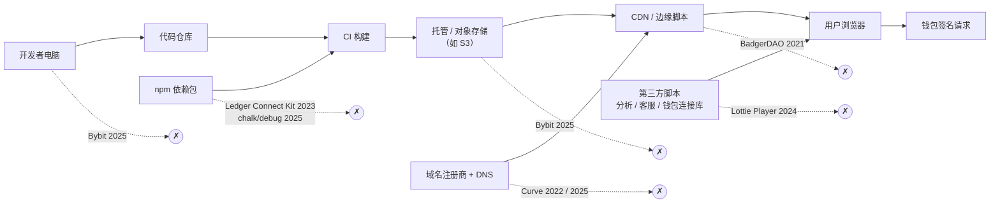
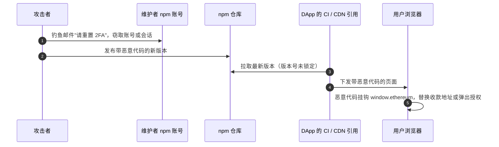
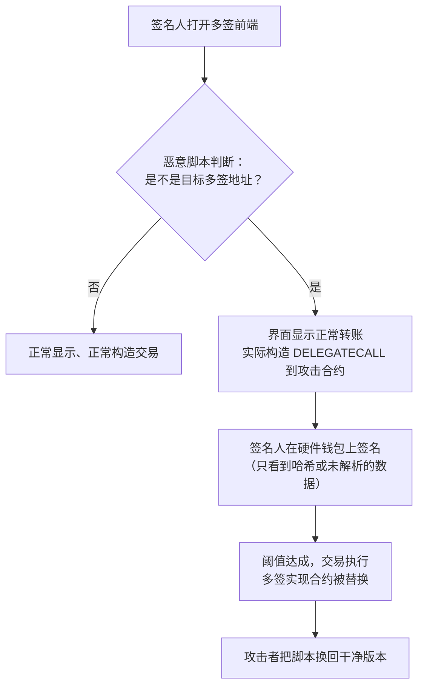
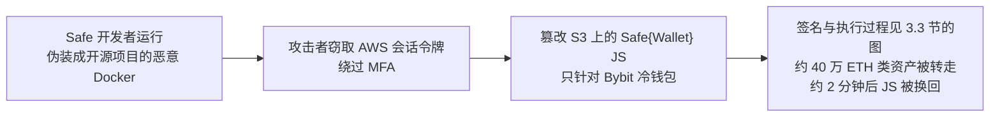

# 20 前端、DNS 与供应链：合约没变，页面变了

> 学习目标：读完本章，你能——
> 1. 画出一个 DApp 从域名到签名请求的完整链路，标出可被篡改的环节。
> 2. 解释 DNS 劫持、依赖包投毒、CDN 与边缘脚本注入、构建发布链路入侵四类攻击。
> 3. 为前端发布流程设计完整性校验和监控。
>
> 前置章节：[18 钱包与密钥管理](18-wallet-key-management.md)、[19 用户侧诈骗](19-user-scams.md)
> 交互实验：[phishing-signature-lab.html](../interactive/phishing-signature-lab.html)（第 8 题：被篡改的多签界面）、[multisig-review-lab.html](../interactive/multisig-review-lab.html)

> 最后核对：2026-11-09
---

## 开场：地址栏是对的

2022 年 8 月，curve.fi 被解析到克隆前端，用户损失约 57 万美元。用户访问的是正确的域名。合约也没有变化。

🤔 先猜再看：攻击者控制了 DNS。用户的浏览器显示域名正确，也显示 HTTPS 锁标志。这能证明页面是真的吗？

不能。控制 DNS 的攻击者可以通过常见的域名验证方式申请到有效证书。域名和锁标志只说明"浏览器连上了这个域名当前解析到的服务器"。

---

## 1. 一句话理解

**用户不读合约，用户读页面。页面告诉用户"这笔交易是什么"，钱包再把页面构造的交易交给用户签名。攻击者改掉页面，就能让用户对着一个审计过的合约签下攻击交易。**

前端（Frontend）：用户在浏览器里看到的网页，以及它加载的全部脚本。
供应链（Supply Chain）：前端从源码到用户浏览器经过的所有环节：依赖包、构建工具、CI、托管、CDN、域名。

> 🎯 打个比方：银行柜台的玻璃上贴着"本行账号：xxx"。金库、账本、保安都没问题。但有人夜里换了玻璃上的贴纸。第二天所有客户都把钱汇到了新账号。
>
> 比喻的局限：换贴纸要进银行大厅。改前端可以在千里之外完成，而且可以只对某一个客户显示假贴纸，其他人看到的都是真的。

---

## 2. 威胁模型：攻击者能控制什么

**读图要点：**

- 每个方框都是一个信任环节。任何一个被攻破，最终结果都一样：用户浏览器里运行了攻击者的代码。
- 合约审计覆盖不到这张图里的任何一个环节。
- 局限：图里没有画浏览器扩展和用户电脑本身。恶意扩展同样可以改写页面，见 [18 章](18-wallet-key-management.md) 5.5 节。

| 环节 | 攻击者控制它之后能做什么 | 典型入口 |
|---|---|---|
| 域名与 DNS | 把整个域名指向克隆站 | 注册商账号被盗、注册商系统被入侵、迁移期 MFA 失效 |
| 依赖包 | 在构建产物里插入代码 | 维护者账号被钓鱼、离职员工权限未回收 |
| 构建与托管 | 替换已发布的 JS 文件 | 开发者电脑被控、云凭证被盗 |
| CDN 与边缘脚本 | 只对部分用户注入脚本 | CDN 账号 API Key 泄露 |
| 第三方脚本 | 在页面里弹出钱包连接 | 第三方库被投毒、未锁版本 |

---

## 3. 攻击路径

### 3.1 DNS 劫持

1. 攻击者控制域名注册商账号，或者攻破注册商本身。
2. 攻击者把域名的 DNS 记录指向自己的服务器。
3. 用户访问正确的域名，看到的是克隆页面。
4. 克隆页面请求 approve 或 permit，见 [19 章](19-user-scams.md)。

> 💡 注意：用户检查了地址栏，域名完全正确。这一步用户层面的检查全部失效。

### 3.2 依赖包投毒

**读图要点：**

- 第 3 步是关键。如果 DApp 锁定了依赖版本，并校验完整性哈希，恶意新版本不会进入页面。
- 从 CDN 动态加载"最新版"的库，风险最大：不经过 DApp 自己的构建，直接进入用户浏览器。
- 局限：锁版本只能挡住"新版本投毒"。如果被锁定的那个版本本身就有恶意代码，需要依赖审查。

### 3.3 只针对一个目标的前端篡改

攻击者不一定改给所有人看。2025 年 Bybit 事件中，被篡改的脚本只在特定多签地址发起交易时生效，其他用户看到的页面完全正常。

**读图要点：**

- 精准投放让异常很难被发现：普通用户、安全研究者、甚至其他项目方都看不到恶意行为。
- 事后换回干净版本，会增加取证难度。所以要保留每个发布版本的哈希和访问日志。
- 防线在 H 步：签名人独立解码，见 [18 章](18-wallet-key-management.md) 3.3 节。

> 🧪 动手验证：打开[多签签前复核](../interactive/multisig-review-lab.html)，在 #43 点击"运行独立解码"。记录前端声称的 safeTxHash 与硬件钱包显示的哈希是否相同，再记录哪些字段被标红。

🤔 先猜再看：恶意脚本只在 Bybit 的多签地址上生效。外部安全研究者从自己的浏览器打开页面，能看到恶意行为吗？

不能，除非研究者模拟出目标条件。Verichains 称载荷只在特定条件下激活。所以外部探测不够，发布方要比对线上文件哈希与构建产物哈希。

---

## 4. 防御方法

### 4.1 域名与 DNS

1. 域名开启注册商锁（Registrar Lock）和注册局锁（Registry Lock）。
2. 注册商账号使用硬件密钥 MFA，只有少数人有权限。
3. 开启 DNSSEC，并监控 DNS 记录、NS 委派、证书透明度日志的变化。
4. 注册商迁移、合并后，立即重新检查 MFA 和账号状态。
5. 准备备用域名，并提前在官方渠道公布。

### 4.2 依赖与构建

1. 锁定全部依赖版本，提交 lockfile；CI 用 `npm ci` 等严格安装模式。
2. 不从 CDN 动态加载"最新版"的第三方库；需要外部脚本时使用子资源完整性（SRI）。
3. 新版本依赖设置等待期，并用依赖扫描工具检查。
4. 发布凭证（npm token、云凭证、应用商店 API Key）使用短期凭证，离职或转岗当天回收。
5. CI 运行在隔离环境；构建产物签名；记录构建来源（provenance）。

### 4.3 托管、CDN 与运行时

1. 托管和 CDN 账号的 API Key 最小权限、定期轮换、有变更告警。
2. 发布后由独立系统比对线上文件哈希与构建产物哈希，不一致时告警。
3. 内容安全策略（CSP）限制脚本来源和连接目标。
4. 保留每个版本的文件哈希和访问日志，用于事后取证。
5. 提供可本地运行或 IPFS 固定哈希的前端版本，给高价值用户和签名人使用。

### 4.4 签名界面（多签、托管后台）

1. 签名人不只看前端：用独立工具重新计算交易哈希，并在硬件钱包上核对。
2. 例行转账的 `operation` 必须是 CALL；DELEGATECALL 进入单独的高级审批流程。
3. 冷钱包签名使用专用、隔离的设备，不在日常办公电脑上操作。

> ⚠️ 警告：所有签名人用同一个网页前端，前端就是这个多签的单点。增加签名人数量，不能解决这个问题。

🤔 先猜再看：部署新版前端后，线上文件哈希和构建产物哈希一致。这能证明用户拿到的页面没有被改过吗？

不能完全证明。比对只覆盖比对时刻、比对位置看到的文件。CDN 边缘脚本可以只对部分用户改写响应。比对要在多个位置反复进行，并监控 CDN 配置变化。

---

## 5. 真实案例

> 💡 注意：以下每个案例只写摘要和教训。完整复盘见《[Web3 行业安全资损 101](../../web3-loss-101/index.html)》。金额为事发时美元估值。

### 5.1 Curve Finance 两次域名劫持（2022 年 8 月、2025 年 5 月）

- **2022 年 8 月**：curve.fi 被解析到克隆前端，诱导用户授权，损失约 57 万美元。项目方称"很可能是 DNS 服务商被黑"。FixedFloat 冻结了 112 ETH。来源：[The Block](https://www.theblock.co/post/162604/)、[ForkLog](https://forklog.com/en/curve-finance-users-lose-573000-in-front-end-attack/)。
- **2025 年 5 月**：攻击者进入同一家注册商的系统，把 curve.fi 的 DNS 委派改到自己的服务器，指向一个索要钱包签名的假页面。Curve 把用户引导到 curve.finance，并公开批评注册商响应迟缓。来源：[Curve 官方说明](https://news.curve.finance/curve-domain-incident/)、[The Block](https://www.theblock.co/post/354067/)。
- 教训：注册商本身是需要管理的风险。同一家注册商出两次事，说明"换个强密码"不够。
- 另见：[资损 101](../../web3-loss-101/index.html#c-curve)

### 5.2 BadgerDAO：CDN 边缘脚本注入（2021 年 12 月，以太坊）

- 攻击者利用 Cloudflare 注册流程的一个漏洞，拿到 Badger 账号下一把未经授权的 API Key。
- 从 2021 年 11 月起，攻击者通过 Cloudflare Workers 向 app.badger.com 周期性注入脚本，只对部分用户弹出授权请求。
- 12 月 2 日，攻击者用这些授权转走约 1.2 亿美元。项目方与 Mandiant、Chainalysis 合作复盘。
- 教训：CDN 和边缘计算账号是前端的信任根。它的 API Key 要有清单、有告警、能审计。
- 来源：[ForkLog（转述项目方复盘）](https://forklog.com/en/badgerdao-team-reveals-details-of-121-million-hack/)、[AMBCrypto](https://ambcrypto.com/badgerdao-reveals-cause-behind-exploit-details-recovery-plan/)、[资损 101](../../web3-loss-101/index.html#c-badger)

### 5.3 Ledger Connect Kit：离职员工的 npm 权限（2023 年 12 月）

- 一名前员工被钓鱼。攻击者用他的会话令牌进入其 npm 账号。Ledger 回收了他的其他权限，但漏了 npm。
- 攻击者先后发布 3 个恶意版本，内嵌 Drainer。很多 DApp 从 CDN 加载"最新版" Connect Kit，恶意代码直接进入它们的页面。
- Ledger 在获知后约 40 分钟内发布修复版本，但 CDN 缓存让恶意文件约 5 小时后才完全清除。损失约 60 万美元。Tether 冻结了攻击者的 USDT。
- 教训：离职权限回收要覆盖所有发布渠道。从 CDN 动态加载、不锁版本的库，会把别人的事故变成你的事故。
- 来源：[Ledger 事件报告](https://www.ledger.com/blog/security-incident-report)、[BleepingComputer](https://www.bleepingcomputer.com/news/security/ledger-dapp-supply-chain-attack-steals-600k-from-crypto-wallets/)、[Fireblocks](https://www.fireblocks.com/blog/ledger-connect-attack-what-you-need-to-know)

### 5.4 Bybit：多签前端被精准篡改（2025 年 2 月，以太坊）

- 损失约 15 亿美元（事发时估值，[FBI](https://www.ic3.gov/psa/2025/psa250226) 口径；各方估算在 14–15 亿美元之间），在当时是最大的单起加密资产盗窃案。2026 年 10 月的 Binance 事件已超过它，见 [23 章](23-custody-exchange-ops.md) 5.2 节。
- FBI 公告归因于朝鲜，称该活动为 TraderTraitor。Sygnia 认为 Safe 的 AWS S3 或 CloudFront 账号或 API Key 很可能泄露；未在 Bybit 基础设施中发现入侵证据。Verichains 称载荷只在特定条件下激活。
- Safe 的初步报告（项目方）称，2 月 4 日开发者电脑因受污染的 Docker 项目失陷。攻击者注册自己的 MFA 设备失败后，劫持了活跃的 AWS 会话令牌。Safe 称智能合约不受影响（[CryptoSlate 转述](https://cryptoslate.com/safes-internal-investigation-reveals-developers-laptop-breach-led-to-bybit-hack/)）。
- 链上结构：`operation = 1`，`data` 是 `transfer(address,uint256)`，目标合约把参数写入 slot 0，替换 Safe 代理的实现地址（[NCC Group](https://www.nccgroup.com/research/in-depth-technical-analysis-of-the-bybit-hack/)）。
- 同一模式的其他事件见 [29 章](29-signing-path-2026.md)。
- 教训：签名前必须在独立环境里重新计算交易哈希、解码调用数据。只相信前端显示，等于把冷钱包交给了前端的托管商。
- 来源：[FBI 公告 I-022625-PSA](https://www.ic3.gov/psa/2025/psa250226)、[BleepingComputer（转引 Sygnia / Verichains）](https://www.bleepingcomputer.com/news/security/lazarus-hacked-bybit-via-a-breached-safe-wallet-developer-machine/)、[资损 101](https://claude.ai/artifact/1a5Nx6xTVLuJdCB8Esf2xj#c-bybit)。事后追踪见 [25 章](25-fund-tracing-response.md)。

### 5.5 npm 生态的持续投毒（2024–2026）

| 时间 | 事件 | 手法 | 影响 | 来源 |
|---|---|---|---|---|
| 2024-10 | Lottie Player | 开发者访问令牌被盗；恶意版本弹出"连接钱包" | 已知至少 1 名用户损失约 10 BTC（单一来源） | [Sonatype](https://www.sonatype.com/blog/lottie-player-compromised-in-supply-chain-attack-all-you-need-to-know)、[Infosecurity](https://www.infosecurity-magazine.com/news/npm-package-lottieplayer-supply/) |
| 2025-09 | chalk / debug 等 18 个包 | 维护者被仿冒 npm 的邮件钓鱼；恶意代码挂钩 `window.ethereum`，替换 6 条链的收款地址 | 包周下载量合计超过 20 亿；已确认的加密损失很小 | [Aikido](https://www.aikido.dev/blog/npm-debug-and-chalk-packages-compromised)、[Endor Labs](https://www.endorlabs.com/learn/major-supply-chain-attack-compromises-popular-npm-packages-including-chalk-and-debug) |
| 2025-09 / 11 | Shai-Hulud 蠕虫 | 自我传播，窃取 npm、GitHub、云凭证；不是专门的盗币工具 | CISA 告警超过 500 个包 | [CISA 告警](https://www.cisa.gov/news-events/alerts/2025/09/23/widespread-supply-chain-compromise-impacting-npm-ecosystem) |
| 2025-12 | Trust Wallet 扩展 | 泄露的 GitHub secrets → 发布恶意扩展版本；项目方认为与 Shai-Hulud 有关 | 约 850 万美元 | 见 [18 章](18-wallet-key-management.md) 5.5 节 |
| 2026-07 | Injective SDK | 贡献者 GitHub 账号被劫持，发布 18 个窃取私钥和助记词的包 | 被弃用前下载 310 次，未见确认损失 | [BleepingComputer](https://www.bleepingcomputer.com/news/security/injective-sdk-on-npm-infected-with-cryptocurrency-wallet-stealer/) |

- 教训：凭证窃取蠕虫的下游是钱包。一次"通用"的供应链事件，几周后可能变成一次钱包事件。

### 5.6 注册商迁移的风险窗口（2024 年 7 月）

- Google Domains 业务迁移到 Squarespace 后，Compound 等多个 DeFi 项目的域名被劫持，指向 Drainer 页面。Celer 通过域名监控拦下了劫持尝试。
- 研究者认为，这与迁移期间 MFA 失效、系统自动为域名建账号有关。Squarespace 没有公布官方根因，损失总额也没有可靠统计。
- 教训：供应商迁移是高危窗口。迁移当天就重新核查 MFA、账号和联系人。
- 来源：[BleepingComputer](https://www.bleepingcomputer.com/news/security/dns-hijacks-target-crypto-platforms-registered-with-squarespace/)、[The Block](https://www.theblock.co/post/304956/)

---

## 6. 评估检查点

- [ ] **FEC-1** 主域名开启注册商锁和注册局锁；注册商账号使用硬件密钥 MFA。
- [ ] **FEC-2** 有 DNS 记录、NS 委派、证书透明度的变化监控，并有人响应。
- [ ] **FEC-3** 依赖全部锁定版本；CI 使用严格安装；没有从 CDN 动态加载"最新版"的库。
- [ ] **FEC-4** 外部脚本使用 SRI；有 CSP 限制脚本来源。
- [ ] **FEC-5** 线上文件哈希与构建产物哈希有自动比对。
- [ ] **FEC-6** 发布凭证使用短期凭证；离职和转岗当天回收全部发布渠道权限，并有清单。
- [ ] **FEC-7** 开发者电脑不运行未审查的外部项目或容器；有终端防护。
- [ ] **FEC-8** 多签和托管后台的签名人有独立解码工具，并在硬件钱包上核对。
- [ ] **FEC-9** 保留每个版本的文件哈希和访问日志。
- [ ] **FEC-10** 有前端被篡改时的应急预案：下线前端、发布公告、通知用户撤销授权。

**把检查结果写进报告：**

| 检查项 | 发现时的证据 | 常见定级（用 [A02](../assessment/A02-risk-rating-reporting.md) 复核） | 练习位置 |
|---|---|---|---|
| FEC-1、FEC-2 | 注册商账号设置；DNS 变更告警记录 | 高 | 本章 5.1 节 |
| FEC-3、FEC-4 | lockfile、CI 配置、页面资源清单、CSP 响应头 | 高 / 中 | 本章 5.3 节 |
| FEC-5、FEC-9 | 线上与构建产物的哈希比对记录 | 高 / 中 | 本章 3.3 节 |
| FEC-6、FEC-7 | 凭证清单；开发环境策略 | 严重 / 高 | [29 章](29-signing-path-2026.md) SIG-11 至 SIG-14 |
| FEC-8 | 一次真实签名的独立解码记录 | 严重 / 高 | [多签签前复核](../interactive/multisig-review-lab.html)、[B40](../bootcamp/B40-case-safe.md) |
| FEC-10 | 应急预案和演练记录 | 高 / 中 | [A09](../assessment/A09-incident-response.md) |

发现按 [T03 报告模板](../templates/T03-finding-report.md) 记录。运营安全的评估范围见 [A06](../assessment/A06-operational-key-security.md)，DApp 对象见 [A04](../assessment/A04-defi-protocol-review.md)。

---

## 7. 用户侧防护

1. 收藏官方网址，从收藏夹进入，不点搜索广告和私信链接。
2. 即使地址栏的域名正确，签名前也要解码签名内容。DNS 劫持时域名是对的。
3. 项目方公告"前端出现异常"时，立刻停止交互，并撤销近期的授权。
4. 钱包在熟悉的网站上突然弹出"重新授权""迁移资产""连接钱包验证"，先停下来核实。
5. 保持钱包扩展和浏览器更新，卸载不用的扩展。

---

## 8. 术语表

| 术语 | 英文 | 定义 |
|---|---|---|
| 前端 | Frontend | 用户浏览器中运行的网页及其加载的全部脚本 |
| 供应链 | Supply Chain | 前端从源码到用户浏览器经过的所有环节 |
| DNS 劫持 | DNS Hijacking | 篡改域名解析，让正确的域名指向攻击者的服务器 |
| 注册商锁 | Registrar Lock | 防止域名被未授权转移或修改的锁定状态 |
| 依赖包投毒 | Dependency Poisoning | 在第三方包中插入恶意代码 |
| 子资源完整性 | SRI | 浏览器校验外部脚本哈希，不一致时拒绝执行 |
| 内容安全策略 | CSP | 限制页面可以加载哪些脚本、连接哪些地址的浏览器策略 |
| 边缘脚本 | Edge Worker | 在 CDN 节点上运行、可以改写响应内容的脚本 |
| 构建来源 | Provenance | 证明某个构建产物由哪份源码、哪个流水线生成的记录 |

---

> 🪞 反思：打开你最常用的一个 DApp，或你负责的前端。
> 1. 页面加载了多少个第三方脚本？你能说出每一个的用途吗？
> 2. 如果今晚有人替换了一个 JS 文件，谁会在多久之后发现？
> 3. 签名人有没有一条不经过这个前端的核对路径？

## 9. 思考题

1. 一个 DApp 的合约经过三家审计，但前端从 CDN 加载未锁版本的钱包连接库。如果你是评估人，这个发现的严重度怎么定？参考 [severity-calculator.html](../interactive/severity-calculator.html)。
2. Bybit 事件中，恶意脚本只针对一个多签地址。哪些监控手段还能发现它？哪些不能？
3. 打开 [phishing-signature-lab.html](../interactive/phishing-signature-lab.html) 第 8 题。如果签名人只能看到 safeTxHash，他需要什么工具和信息才能发现异常？

下一章：[21 社工与内部人](21-social-engineering-insiders.md) —— 攻击者先攻破人。
