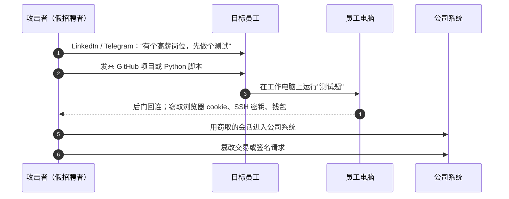
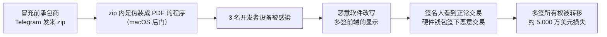

# 21 社工与内部人：攻击者先攻破人

> 学习目标：读完本章，你能——
> 1. 说出假招聘、假面试、恶意文件、假会议软件四类针对 Web3 员工的典型社工手法。
> 2. 为关键岗位设计入职、权限交接和离职的安全流程。
> 3. 识别内部人风险的早期信号，并设计职责分离。
>
> 前置章节：[18 钱包与密钥管理](18-wallet-key-management.md)、[20 前端、DNS 与供应链](20-frontend-dns-supply-chain.md)
> 配套模板：[T07 员工防社工清单](../templates/T07-staff-anti-social-engineering.md)
> 交互实验：[social-engineering-lab.html](../interactive/social-engineering-lab.html)

> 最后核对：2026-11-09

---

## 开场：一份面试作业

2026 年 9 月，一名 Binance 工程师接到面试邀约，并参加了视频面试。面试结束前，对方让他把一份“作业”仓库下载到工作电脑上。一个月后，受影响的资产约 63.4 亿美元。

🤔 先猜再看：这名工程师没有输入密码，也没有点钓鱼链接。作业仓库靠什么进入他的电脑？

靠安装脚本。仓库的安装步骤运行了混淆的命令，把合法的 pyenv 组件替换成恶意版本。在工作电脑上运行外部代码，这一步就够了。5.8 节有完整路径。

---

## 1. 一句话理解

**最贵的漏洞常在员工的电脑上。攻击者不去破解多签合约，而是让一个签名人在自己的电脑上打开一个文件。之后，这台电脑上显示的一切都可能是假的。**

社会工程（Social Engineering）：通过欺骗、诱导或利用信任，让人主动执行攻击者需要的动作。
内部人风险（Insider Risk）：有合法权限的人，有意或无意地造成损失。

> 🎯 打个比方：金库有三道门，每道门由不同的人掌管钥匙。窃贼不撬门，而是分别给三个掌钥人寄了一封"老同事的来信"。信纸上涂了药，读信的人会在第二天"记错"自己开的是哪道门。
>
> 比喻的局限：真实的攻击者不需要同时骗三个人。只要签名人的电脑都运行同一个前端，攻破其中几台电脑，再配合前端篡改，就可能凑够阈值。

---

## 2. 威胁模型：攻击者能控制什么

| 攻击者能控制的东西 | 典型手法 | 目标岗位 |
|---|---|---|
| 一个假身份 | 冒充招聘者、前同事、合作方、媒体记者 | 开发者、签名人、运维 |
| 一个"任务" | 入职测试题、代码作业、PDF 复盘、合同 | 开发者、求职者 |
| 一个会议 | 假会议软件、远程控制请求 | 高管、BD、投资人 |
| 一笔钱 | 贿赂客服或外包人员 | 客服、外包、运营 |
| 一个被雇用的身份 | 冒名应聘远程岗位 | 开发、运维 |

> 💡 注意：公开通报显示，朝鲜相关组织在这一类攻击中最活跃。但手法本身被各类犯罪团伙复用。防御不应该只针对某一个组织。

---

## 3. 攻击路径

### 3.1 假招聘与假面试

**读图要点：**

- 第 3 步是关键：员工在**工作电脑**上运行了外部代码。
- 第 4 步窃取的是会话 cookie，不是密码。会话 cookie 可以绕过 MFA。
- 攻击常常在入侵后潜伏数周到数月，等待一笔大额交易。
- 局限：项目的 `.vscode/tasks.json`、`package.json` 的 `postinstall`、Docker 镜像都可以在"打开项目"时自动执行代码。

🤔 先猜再看：员工的账号启用了硬件密钥 MFA。攻击者偷走了他已登录的会话 cookie。硬件密钥能挡住吗？

通常不能。硬件密钥保护登录这一步。会话 cookie 是登录之后的凭证。防线是短会话、会话绑定设备、异地告警。

> 🧪 动手验证：打开[社工场景判断](../interactive/social-engineering-lab.html)，完成全部 11 个场景。记录总分，以及“手法分项”里得分最低的手法。

### 3.2 恶意文件与签名人终端

**读图要点：**

- 这是 2024 年 Radiant Capital 事件的路径（见 5.1 节）。
- 签名人用了硬件钱包，也用了交易模拟。但终端被控制后，界面显示的模拟结果也是假的。
- 防线：签名人用**另一台**干净设备独立解码；签名设备不处理外部文件。

### 3.3 假会议软件与远程控制

1. 攻击者冒充媒体或投资机构，邀请目标参加访谈或路演。
2. 攻击者要求目标下载一个"专用会议软件"，或在会议中申请远程控制。
3. 远程控制申请时，攻击者把自己的显示名改成"Zoom"，让授权弹窗看起来像系统提示。
4. 目标点击同意后，攻击者控制电脑，打开钱包或密码管理器。

🤔 先猜再看：弹窗写着“Zoom 请求控制你的屏幕”。这能证明请求来自 Zoom 软件吗？

不能。“Zoom”可以是会议参与者的显示名。这个弹窗说的是某个参与者请求控制。公司设备应该默认关闭远程控制。

### 3.4 冒名受雇的远程员工

1. 攻击者用盗用或伪造的身份应聘远程开发岗位。
2. 入职后，攻击者获得代码仓库、部署或合约发布权限。
3. 攻击者在代码中插入后门，或直接修改合约把资金转走。
4. 公司发现时，攻击者已经离开，身份无法追查。

---

## 4. 防御方法

### 4.1 设备分离

| 设备 | 用途 | 禁止 |
|---|---|---|
| 签名专用设备 | 只用于签名和独立解码 | 收邮件、上 Telegram、打开外部文件、运行外部代码 |
| 日常办公电脑 | 沟通、文档 | 存放生产凭证、私钥 |
| 开发电脑 | 开发 | 运行未审查的外部项目；如需运行，使用隔离虚拟机或一次性环境 |

### 4.2 流程控制

1. **双人原则**：资金操作、合约发布、权限变更，至少两人独立确认。
2. **带外确认**：大额交易和权限变更，用预先登记的电话或当面确认，不用发起请求的同一渠道。
3. **最小权限**：员工只拥有当前岗位需要的权限；临时权限有到期时间。
4. **职责分离**：发起人、审批人、执行人、审计人不是同一个人。
5. **会话安全**：关键系统使用硬件密钥 MFA，会话短期有效，异地登录告警。

> 🧪 动手验证：在[社工场景判断](../interactive/social-engineering-lab.html)里比较“紧急签名”“收款变更”和第二个“正常流程”（变更单 CHG-2041）三题的解释。写下三题中用来区分真假的信号。

### 4.3 招聘、入职与离职

| 阶段 | 检查项 |
|---|---|
| 招聘 | 视频面试本人出镜；核验身份证件与履历；背景调查；远程岗位核验收货地址与设备所在地 |
| 入职 | 公司配发设备；不允许个人设备接入生产系统；签署安全守则；完成防社工培训 |
| 在职 | 权限每季度复核；异常行为监控（大量导出、非工作时间访问、访问与岗位无关的数据） |
| 转岗 | 当天回收旧岗位权限 |
| 离职 | 当天回收**全部**权限：代码仓库、云、CI、包管理器、域名、社交账号、多签签名人身份；轮换共享凭证 |

> ⚠️ 警告：离职回收清单必须覆盖"边缘"权限：npm、应用商店、域名注册商、官方社交账号、多签签名人地址。Ledger Connect Kit 事件就是因为漏了 npm 权限（见 [20 章](20-frontend-dns-supply-chain.md)）。

### 4.4 内部人风险的早期信号

- 访问与当前任务无关的系统或数据。
- 短时间内大量查询或导出用户数据。
- 要求绕过审批流程，理由是"紧急"。
- 在非工作时间、从异常位置登录。
- 拒绝休假或轮岗，坚持独自处理某类操作。

---

## 5. 真实案例

> 💡 注意：以下每个案例只写摘要和教训。完整复盘见《[Web3 行业安全资损 101](../../web3-loss-101/index.html)》。金额为事发时美元估值。

### 5.1 Radiant Capital：一个 zip 文件（2024 年 10 月，Arbitrum / BSC）

- 2024 年 9 月，攻击者冒充前承包商，在 Telegram 发来伪装成复盘 PDF 的 macOS 后门。完整路径见 3.2 节的图。10 月 16 日多签所有权被转移，约 5,000 万美元。Mandiant 高置信度归因于朝鲜相关组织 UNC4736。
- 资金未追回。2026 年 6 月，项目 DAO 宣布进入关停维护状态。
- 教训：交易模拟和多签挡不住签名设备本身被控制。签名设备必须与外部文件、聊天软件隔离。
- 来源：[SecurityWeek](https://www.securityweek.com/radiant-capital-50-million-heist-blamed-on-north-korean-hackers/)、[crypto.news（转引项目方复盘）](https://crypto.news/dprk-linked-hackers-social-engineered-50m-radiant-capital-exploit-report/)、[资损 101](../../web3-loss-101/index.html#c-radiant)

### 5.2 DMM Bitcoin：供应商员工的"入职测试"（2024 年 5 月，Bitcoin）

- 2024 年 3 月，攻击者在 LinkedIn 冒充招聘者，让钱包软件供应商 Ginco 的一名员工运行一个恶意 Python"测试脚本"。
- 5 月，攻击者用窃取的会话 cookie 进入 Ginco 系统，篡改了 DMM 的一笔交易，盗走 4,502.9 BTC（约 3.05 亿美元，482 亿日元）。
- 2024 年 12 月，FBI、美国国防部网络犯罪中心与日本警察厅联合归因于 TraderTraitor（朝鲜）。
- DMM 筹资购回 BTC，全额保障客户，之后宣布停业，账户迁往其他交易所。
- 教训：供应商的员工也是你的攻击面。供应商尽调要覆盖它的终端安全和会话管理。
- 来源：[日本警察厅通报](https://www.npa.go.jp/bureau/cyber/koho/caution/caution20241224.html)、[Security Affairs](https://securityaffairs.com/172290/)、[资损 101](https://claude.ai/artifact/1a5Nx6xTVLuJdCB8Esf2xj#c-dmm)

### 5.3 假面试活动的规模（2024–2026）

- 2026 年 9 月，美国国防部网络犯罪中心、FBI、日本警察厅等多国机构联合告警"Contagious Interview"（又称 WaterPlum）活动：2025 年 12 月至 2026 年 7 月，至少 3 万台设备被感染，涉及 7,000 多个钱包。告警建议用受限模式打开陌生项目，并检查 `.vscode/tasks.json`。
- 2025 年 6 月，美国司法部搜查了 14 个州的 21 处"笔记本电脑农场"，打击冒名受雇的朝鲜 IT 工人。
- 2026 年 3 月，OFAC 制裁了协助朝鲜 IT 工人的中间人，并公布了 21 个加密地址。
- 教训：招聘和入职流程是安全控制的一部分。OFAC 公布的地址要进入制裁筛查，见 [23 章](23-custody-exchange-ops.md)。
- 来源：[美国国防部网络犯罪中心联合告警](https://content.govdelivery.com/accounts/USDODDC3/bulletins/42b69c9)、[TechCrunch](https://techcrunch.com/2025/06/30/us-government-takes-down-major-north-korean-remote-it-workers-operation/)、[Palo Alto Unit 42](https://unit42.paloaltonetworks.com/two-campaigns-by-north-korea-bad-actors-target-job-hunters/)

### 5.4 冒名受雇后修改合约（2022 年，2025 年起诉）

- 美国检方 2025 年 6 月起诉 4 名朝鲜人：他们用盗用的身份受雇于一家美国区块链初创公司和一家塞尔维亚代币公司。
- 其中一人修改了雇主两个智能合约的源码，把约 74 万美元转到自己的地址。全案约 91.5 万美元。4 人均在逃。
- 教训：有合约发布权限的远程员工要做身份核验；代码合并必须有他人审查。
- 来源：[美国司法部佐治亚北区新闻稿](https://www.justice.gov/usao-ndga/pr/four-north-koreans-charged-nearly-1-million-cryptocurrency-theft-scheme)、[Decrypt](https://decrypt.co/327942/)

### 5.5 假会议软件（2025 年）

- **ELUSIVE COMET（2025 年 4 月）**：冒充财经媒体邀请访谈，在 Zoom 通话中把显示名改成"Zoom"，再申请远程控制。Trail of Bits 公开了这一手法，并给出禁用 Zoom 辅助功能权限的配置。来源：[Trail of Bits](https://blog.trailofbits.com/2025/04/17/mitigating-elusive-comet-zoom-remote-control-attacks/)、[Help Net Security](https://www.helpnetsecurity.com/2025/04/18/zoom-remote-control-attack/)。
- **GrassCall（2025 年 2 月）**：发布假 Web3 职位，引导求职者安装"GrassCall"会议软件，投放窃密木马。来源：[BleepingComputer](https://www.bleepingcomputer.com/news/security/grasscall-malware-campaign-drains-crypto-wallets-via-fake-job-interviews/)。
- 教训：会议只用公司批准的软件和网页版；远程控制默认禁用。

### 5.6 被收买的客服（2025 年 5 月，Coinbase）

- 2025 年 5 月，攻击者用现金收买 Coinbase 的海外外包客服，导出约 7 万名用户的数据，再冒充 Coinbase 行骗。Coinbase 估算成本 1.8–4 亿美元。
- 教训：外包客服的数据访问要最小化，并监控异常查询。数据字段、赔付和后续进展见 [24 章 5.2 节](24-data-privacy.md)。
- 来源：[资损 101](../../web3-loss-101/index.html#c-coinbase25)

### 5.7 "兼职"诱饵与被利用的员工（2025 年 7 月，CoinDCX）

- 攻击者以"兼职工作"为饵，让一名员工在公司电脑上安装了恶意软件，借此从运营流动性钱包盗走约 4,400 万美元。
- 当地警方逮捕了该员工，但称他"不知情，只是被利用的工具"。客户资金未受影响，损失由交易所承担。
- 教训：员工在公司设备上做私事，就是把公司的权限借给了陌生人。
- 来源：[Cointelegraph](https://cointelegraph.com/news/coindcx-hack-employee-arrested-44m-crypto-theft)、[Deccan Herald](https://www.deccanherald.com/india/karnataka/bengaluru/employee-arrested-in-bengaluru-after-crypto-exchange-loses-44-million-in-cyberattack-3656871)

### 5.8 假面试和被篡改的工具走到签名服务（2026 年 10 月，Binance）

- 2026 年 9 月，一名工程师经正规招聘平台接到邀约，并参加了视频面试。工程师在工作电脑上下载了作业仓库。
- 仓库在安装时运行恶意代码，替换了合法的 pyenv 组件。当时的终端防护没有发现。
- 6 月还有另一名工程师下载了被篡改的 Homebrew。Binance 当时发现并处置了这台设备，但报告称攻击者由此了解了工程师的角色和同事。
- 10 月，攻击者横向控制更多工程师的电脑，找到部署令牌。见 [23 章](23-custody-exchange-ops.md) 5.2 节。来源：[Binance 初步报告](https://www.linkedin.com/pulse/29-october-binance-security-incident-initial-findings-response-modgf/)、[资损 101](https://claude.ai/artifact/1a5Nx6xTVLuJdCB8Esf2xj#c-binance)。
- 同年 4 月的 Drift 事件走了另一条路：攻击者伪装成量化公司，在行业会议上接触贡献者，经营数月后诱导 2 名安全委员会成员预签审批。来源：[Chainalysis](https://www.chainalysis.com/blog/lessons-from-the-drift-hack/)、[Unchained](https://unchainedcrypto.com/drift-protocol-reveals-285-million-exploit-was-a-six-month-north-korean-intelligence-operation-unchained/)。
- 教训：一次处置完成，不代表威胁结束。员工被社工后，要把攻击者已掌握的组织信息也算进风险。

---

## 6. 评估检查点

- [ ] **SOC-1** 签名人使用专用设备；该设备不安装聊天软件，不打开外部文件。
- [ ] **SOC-2** 开发者运行外部项目必须在隔离环境中；终端有 EDR 防护。
- [ ] **SOC-3** 关键系统使用硬件密钥 MFA；会话短期有效；异地登录告警。
- [ ] **SOC-4** 资金操作、合约发布、权限变更遵循双人原则和带外确认。
- [ ] **SOC-5** 发起、审批、执行、审计四个角色分离。
- [ ] **SOC-6** 招聘有身份核验和背景调查；远程岗位核验设备所在地。
- [ ] **SOC-7** 离职权限回收清单覆盖代码仓库、云、CI、包管理器、域名、社交账号、多签签名人。
- [ ] **SOC-8** 客服和外包对用户数据的访问最小化，有异常查询监控。
- [ ] **SOC-9** 全员每年至少一次防社工培训和钓鱼演练，签名人每季度一次。
- [ ] **SOC-10** 有匿名报告渠道；员工报告可疑接触不受惩罚。

**把检查结果写进报告：**

| 检查项 | 发现时的证据 | 常见定级（用 [A02](../assessment/A02-risk-rating-reporting.md) 复核） | 练习位置 |
|---|---|---|---|
| SOC-1、SOC-2 | 设备清单、EDR 覆盖率、外部代码运行规定与抽查 | High | [社工场景判断](../interactive/social-engineering-lab.html) |
| SOC-3 | MFA 类型、会话时长、异地告警记录 | High | [A06 运营与密钥安全](../assessment/A06-operational-key-security.md) |
| SOC-4、SOC-5 | 审批流配置、带外确认记录、角色表 | Critical / High（资金操作缺失时） | [B40 Safe](../bootcamp/B40-case-safe.md) |
| SOC-6、SOC-7 | 招聘核验记录；离职回收清单与实际回收日志 | High / Medium | [T07](../templates/T07-staff-anti-social-engineering.md) |
| SOC-8 | 客服查询审计；外包访问范围 | High | [24 章](24-data-privacy.md) |
| SOC-9、SOC-10 | 培训和演练记录、报告统计 | Medium / Low | [T06](../templates/T06-ops-security-self-check.md) |

发现按 [T03 报告模板](../templates/T03-finding-report.md) 记录。

完整检查表见 [T07 员工防社工清单](../templates/T07-staff-anti-social-engineering.md) 和 [T06 运营安全自查](../templates/T06-ops-security-self-check.md)。

---

## 7. 用户侧防护

普通用户也会遇到同样的手法：

1. "招聘者"让你下载项目、运行脚本、安装会议软件，先停下来。正规公司不需要你在自己电脑上运行他们的代码。
2. 不在存放钱包的电脑上运行陌生项目、打开陌生文件。
3. 会议中拒绝任何远程控制请求。
4. "客服"主动联系你，说你的账户有风险、要你转移资产，一律挂断，再从官方 App 内联系客服。
5. 交易所员工不会要你把资产转到"安全地址"。

---

## 8. 术语表

| 术语 | 英文 | 定义 |
|---|---|---|
| 社会工程 | Social Engineering | 通过欺骗或利用信任，让人主动执行攻击者需要的动作 |
| 内部人风险 | Insider Risk | 有合法权限的人造成的损失 |
| 双人原则 | Four-Eyes Principle | 关键操作至少由两人独立确认 |
| 职责分离 | Segregation of Duties | 发起、审批、执行、审计由不同的人承担 |
| 带外确认 | Out-of-Band Verification | 用与请求不同的渠道确认请求真实性 |
| 会话劫持 | Session Hijacking | 窃取登录后的会话凭证，绕过密码和 MFA |
| 终端检测与响应 | EDR | 在员工设备上检测并响应恶意行为的软件 |
| 冒名受雇 | Fraudulent Hiring | 用盗用或伪造身份获得岗位和权限 |

---

> 🪞 反思：回想你最近一次在工作电脑上运行别人给的代码或文件。
> 1. 它来自谁？你用什么渠道确认过对方的身份？
> 2. 这台电脑上有哪些凭证和会话？
> 3. 如果它是恶意的，你的团队多久能发现？你敢上报吗？

## 9. 思考题

1. 你的团队有 5 个多签签名人。如何在不增加签名人数量的前提下，让"攻破 3 台电脑"不足以转走资金？
2. 一位候选人技术面试表现优秀，但始终不愿开摄像头，要求把设备寄到一个与简历不符的地址。你会怎么处理？
3. 对照 [T07 员工防社工清单](../templates/T07-staff-anti-social-engineering.md)，你所在团队有几项做不到？先补哪一项？

下一章：[22 人身与账号安全](22-physical-account-security.md) —— 从链上走到线下。
