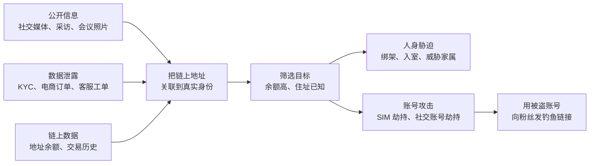
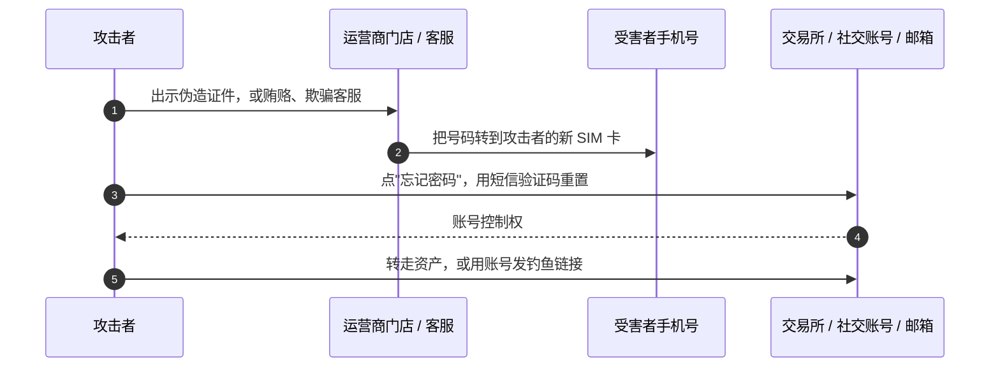

# 22 人身与账号安全：从链上走到线下

> 学习目标：读完本章，你能——
> 1. 解释扳手攻击的成因，以及数据泄露如何把链上身份连到线下住址。
> 2. 识别社交账号（X、Discord、Telegram）被劫持后的典型诈骗路径，以及 SIM 卡劫持的作用。
> 3. 为高净值用户和项目方关键人员设计人身与账号防护措施。
>
> 前置章节：[21 社工与内部人](21-social-engineering-insiders.md)
> 相关章节：[24 数据与隐私](24-data-privacy.md)
> 交互实验：[personal-risk-lab.html](../interactive/personal-risk-lab.html)

> 最后核对：2026-11-09

---

## 开场：一张 SIM 卡的价格

2024 年 1 月，美国 SEC 的官方 X 账号发布了“比特币 ETF 获批”的假消息。BTC 价格短时大幅波动。攻击者没有破解 SEC 的任何系统，只是换了一张 SIM 卡。

🤔 先猜再看：SEC 是监管机构。当时这个账号启用了 MFA 吗？

没有。SEC 承认，此前曾请 X 关闭这个账号的 MFA。攻击者对绑定的手机号做 SIM 卡劫持，再用重置码登录。5.4 节有来源。

---

## 1. 一句话理解

**密码学挡不住扳手。攻击者知道你是谁、住在哪里、持有多少资产时，最便宜的攻击方式就是找到你本人。**

扳手攻击（Wrench Attack）：用暴力或威胁胁迫持币人交出私钥或转账。名称来自一幅漫画：花一百万美元的算力破解不了加密，花五美元买一把扳手就够了。

> 🎯 打个比方：你给家门装了一把银行级的锁。但你的门牌号、作息时间和保险柜里有多少钱，都写在一张贴在网上的海报上。锁越好，劫匪越不会去撬锁，而是等你回家。
>
> 比喻的局限：劫匪需要知道你有钱。链上资产的特点是：一旦地址和身份被关联，余额对全世界公开。

---

## 2. 威胁模型：攻击者能控制什么

**读图要点：**

- 攻击的第一步是"关联"：把一个链上地址和一个真实的人、一个真实的住址连在一起。
- 数据泄露直接给了攻击者住址。所以 [24 章](24-data-privacy.md) 的数据保护，也是人身安全措施。
- 账号攻击有两个目标：一是控制受害者自己的资产，二是借受害者的影响力骗他的粉丝。
- 局限：图里没有画"熟人作案"。公开案例显示，施暴者有时是认识受害者的同行。

---

## 3. 攻击路径

### 3.1 扳手攻击

1. 攻击者从公开信息或泄露数据中确认目标持有大量资产。
2. 攻击者确认目标或其家属的住址和行踪。
3. 攻击者在住所、街头或会面地点控制目标或其家属。
4. 攻击者胁迫目标转账，或用伤害家属的方式勒索赎金。

> 💡 注意：公开报道显示，部分团伙把执行环节外包给临时招募的人员，目标从持币人本人扩展到家属。

### 3.2 SIM 卡劫持

**读图要点：**

- SIM 卡劫持（SIM Swap）：攻击者让运营商把受害者的手机号转到自己的 SIM 卡上。
- 第 3 步之所以成功，是因为账号允许"短信验证码"作为唯一的恢复方式。
- 防线有两层：运营商侧锁定号码转移；账号侧不用短信作为 MFA 或恢复方式。

🤔 先猜再看：账号启用了验证器 App（TOTP），但“忘记密码”仍可用短信验证码。攻击者换卡后能重置账号吗？

取决于平台流程，但这个入口本身就是风险。只要短信能单独完成恢复，TOTP 就被绕过了。第二因素的强度等于恢复流程里最弱的一环。

> 🧪 动手验证：打开[关键人员风险自评](../interactive/personal-risk-lab.html)，岗位选“多签签名人”，回答全部 15 题，记录排在第一的动作。把岗位改成“官方社交账号管理员”，记录第一项是否变化。

### 3.3 社交账号劫持

| 入口 | 手法 | 账号被盗后 |
|---|---|---|
| SIM 卡劫持 | 用短信重置密码 | 发布假公告、假空投、假 NFT 铸造链接 |
| 弱密码或 MFA 失效 | 暴力破解；团队交接中 MFA 被关闭 | 冒充其他项目推广 Drainer 页面 |
| 冒充平台官方 | "版权侵权""账号违规申诉"钓鱼邮件 | 推广假代币，获利后删帖 |
| 管理员权限滥用 | Discord 机器人或管理员账号被盗 | 在官方频道发布钓鱼公告 |

> ⚠️ 警告：官方账号被盗后发出的链接，粉丝几乎没有理由怀疑。这是钓鱼转化率最高的渠道之一，见 [19 章](19-user-scams.md)。

---

## 4. 防御方法

### 4.1 降低暴露

1. 不公开谈论个人持仓、不晒资产截图。
2. 链上身份与真实身份分离：公开收款地址和个人大额地址分开。
3. 住址使用代收地址或公司地址收货，尤其是硬件钱包订单。
4. 社交媒体照片不暴露住址、车牌、日常路线。
5. 定期搜索自己的姓名和住址，在数据经纪网站申请删除。

### 4.2 降低胁迫收益

1. 大额资产使用多签或时间锁，需要异地的另一个人或另一台设备才能转出。被胁迫时，本人确实无法立即转出。
2. 随身设备只放少量资产。
3. 与家人约定胁迫暗号和紧急联系流程。
4. 为关键人员和家属提供安保评估。

> 💡 注意：多签和时间锁降低的是"立即转出"的可能。它不能保证人身安全。公开攻击中，劫匪对"无法转出"的反应难以预测。人身安全第一，资产第二。

🤔 先猜再看：持币人被胁迫，资产在 48 小时时间锁后才能转出。时间锁保护了什么，没有保护什么？

保护了资产：攻击者无法当场转走，异地的人有时间撤销交易。没有保护人身：胁迫可能持续，攻击者也可能不相信“转不出”。所以还要有暗号、紧急联系流程和报警预案。

### 4.3 账号安全

| 措施 | 说明 |
|---|---|
| 硬件安全密钥 | 邮箱、交易所、社交账号、域名注册商都用硬件密钥（FIDO2 / 通行密钥）作为 MFA |
| 关闭短信恢复 | 不用短信作为 MFA 或密码恢复方式 |
| 运营商号码锁 | 向运营商申请号码转移锁或 SIM 更换 PIN |
| 专用邮箱 | 关键账号用不公开的专用邮箱注册 |
| 官方账号交接 | 团队交接时 MFA 不关闭；用组织账号管理，不用个人账号 |
| 发帖权限分离 | 官方账号的发帖权限与恢复权限分开 |

### 4.4 项目方与交易所关键人员

1. 列出关键人员：创始人、多签签名人、运维负责人、官方账号管理员。
2. 为他们提供硬件密钥、号码锁、数据删除服务和安保咨询。
3. 签名人名单不公开；必要时只公开机构，不公开个人。
4. 官方社交账号有被盗应急预案：备用公告渠道、平台联系人、预先准备的辟谣声明。

---

## 5. 真实案例

> 💡 注意：本章案例涉及人身伤害。我们只引用官方通报和主流媒体公开的事实，不写受害人的个人细节。

### 5.1 扳手攻击的数量趋势

| 年份 | 公开记录的实体攻击 | 其中法国 |
|---|---|---|
| 2023 | 74 起 | — |
| 2024 | 106 起 | 6 起 |
| 2025 | 170 起 | 25 起 |
| 2026（截至 10 月 31 日） | 147 起 | 52 起 |

- 数据来自 Jameson Lopp 在 GitHub 维护的公开清单，按 2026 年 11 月 9 日快照逐行统计（法国按地点栏统计）。清单会补录旧案，所以早期媒体引用的数字更低。
- TRM、CertiK 等机构也有统计，口径不同，数字不可直接比较。例如 2026 年上半年，CertiK 统计 52 起，Chainalysis 统计 46 起。Lopp 本人认为真实数量被低估。来源：[Decrypt（CertiK）](https://decrypt.co/374136/crypto-wrench-attacks-cost-victims-124m-in-six-months-up-12x-certik)、[Decrypt（Chainalysis）](https://decrypt.co/375014/crypto-wrench-attacks-30m-stolen-2026-chainalysis)。
- 来源：[physical-bitcoin-attacks（研究者原始数据）](https://github.com/jlopp/physical-bitcoin-attacks)、[The Block](https://www.theblock.co/post/384018/)、[Decrypt（引用 CertiK）](https://decrypt.co/356604/)

### 5.2 2025 年法国连续绑架案

- **2025 年 1 月**：Ledger 联合创始人 David Balland 与伴侣在家中被劫持，绑匪切下他一根手指，向 Ledger 方面索要加密货币赎金。法国宪兵特种部队救出两人。涉嫌主谋 2025 年 6 月在摩洛哥落网，2026 年 5 月被当地法院判处 25 年。来源：[Fortune](https://fortune.com/europe/2025/01/24/french-military-police-rescue-co-founder-13bn-crypto-startup-ledger-bungled-paris-kidnapping-goes-wrong/)、[The Block](https://www.theblock.co/post/356980/)。
- **2025 年 5 月初**：一名加密企业家的父亲在巴黎街头被绑走，被索要数百万欧元赎金。警方突袭解救，没有支付赎金。来源：[The Block](https://www.theblock.co/post/353062/)、[NPR 转载](https://www.mtpr.org/2025-05-04/kidnappers-in-france-target-cryptocurrency-entrepreneurs-for-ransom)。
- **2025 年 5 月 13 日**：交易所 Paymium CEO 的女儿和外孙在巴黎街头遭绑架未遂，受害人反抗、路人帮助，袭击者逃走。检方之后起诉了 25 人，并认为与 5 月初的绑架有关联。来源：[CoinDesk](https://www.coindesk.com/business/2025/05/15/crypto-exchange-ceos-daughter-grandson-targeted-in-paris-kidnap-attempt)。
- **法国政府回应**：内政部长会见业界，宣布为加密行业人士提供安全简报、紧急呼叫优先响应、住宅安防检查等措施（媒体转述）。来源：[Cointelegraph](https://cointelegraph.com/news/french-crypto-entrepreneurs-and-families-to-receive-extra-security-amid-recent-attacks)。
- 教训：创始人和高管的家属住址也是攻击面，需要纳入保护范围。

### 5.3 纽约联排别墅案（2025 年 5 月）

- 检方指控：两名加密投资者把一名意大利籍男子诱到曼哈顿的一处住宅，囚禁并施虐 17 天，逼他交出比特币密码。受害人逃出后报警。两名被告不认罪，案件仍在审理中（截至本书核查时未查到判决）。
- 教训：施暴者可能是熟人或同行。与人线下会面讨论资产，要选择公共场所，并让他人知道行程。
- 来源：[ABC7](https://abc7news.com/post/2-men-charged-alleged-crypto-torture-case-soho-nyc-plead-not-guilty/16723672/)、[Decrypt](https://decrypt.co/323260/)

### 5.4 社交账号被劫持

- **美国 SEC 官方 X 账号（2024 年 1 月）**：攻击者对绑定账号的手机号做 SIM 卡劫持，用重置码登录，发布"比特币 ETF 获批"的假消息，BTC 价格短时大幅波动。SEC 承认此前曾请 X 关闭该账号的 MFA。负责换卡的人 2025 年被判 14 个月。来源：[SEC 声明](https://www.sec.gov/secgov-x-account)、[美国司法部](https://www.justice.gov/opa/pr/alabama-man-sentenced-14-months-connection-securities-and-exchange-commission-x-hack-spiked)。
- **Vitalik Buterin 的 X 账号（2023 年 9 月）**：被盗账号发布假"纪念 NFT"链接，粉丝签名后钱包被清空，约 69.1 万美元（ZachXBT 统计）。入侵手段未被官方证实。来源：[CoinDesk](https://www.coindesk.com/business/2023/09/11/691k-stolen-as-hackers-take-over-vitalik-buterins-x-account)。
- **Mandiant 的 X 账号（2024 年 1 月）**：账号被改名冒充 Phantom 钱包，推广 Drainer 页面。Mandiant 自查认为"很可能被暴力破解"，账号的 2FA 因团队交接和平台政策变化未得到有效保护。来源：[SecurityWeek](https://www.securityweek.com/mandiant-details-crypto-theft-campaign-that-hacked-its-x-account-via-brute-force-attack/)。
- **项目账号批量被盗（2024 年底–2025 年）**：攻击者冒充 X 官方发送"版权侵权"通知，诱导受害人在假页面重置密码和 2FA，接管 15 个加密类账号推广假代币，约 50 万美元。来源：[Cointelegraph](https://cointelegraph.com/news/attacker-hacks-15-x-accounts-steals-half-million-bogus-memecoins)、[SentinelOne](https://www.sentinelone.com/labs/phishing-on-x-high-profile-account-targeting-campaign-returns/)。
- 教训：连安全公司和监管机构的账号都会被盗。官方账号必须使用硬件密钥，交接流程不能关闭 MFA。

### 5.5 SIM 卡劫持与交易所（2022 年 11 月，FTX）

- 美国联邦起诉书称：一个团伙对"受害公司-1"的一名员工做 SIM 卡劫持，转走超过 4 亿美元的加密资产。媒体援引消息源确认受害公司为 FTX，时间是其申请破产当天。
- 一名被告 2024 年认罪，其他被告的结果截至本书核查时未查到。
- 教训：员工的手机号是交易所的特权凭证。员工账号同样不能以短信作为恢复方式。
- 来源：[CNBC](https://www.cnbc.com/2024/02/02/three-people-indicted-in-400-million-ftx-hack-conspiracy.html)、[NBC News](https://www.nbcnews.com/tech/crypto/three-people-indicted-400-million-ftx-hack-conspiracy-rcna136976)

---

## 6. 评估检查点

- [ ] **PHY-1** 关键人员名单已建立，并有对应的防护措施。
- [ ] **PHY-2** 关键人员的邮箱、交易所、社交账号、域名注册商账号使用硬件密钥 MFA，关闭短信恢复。
- [ ] **PHY-3** 关键人员的手机号已向运营商申请转移锁。
- [ ] **PHY-4** 官方社交账号由组织账号管理；发帖和恢复权限分离；交接流程不关闭 MFA。
- [ ] **PHY-5** 有官方账号被盗的应急预案：备用公告渠道、平台联系人、辟谣模板。
- [ ] **PHY-6** 多签签名人名单不公开。
- [ ] **PHY-7** 大额资产不由单人在单一地点即可立即转出。
- [ ] **PHY-8** 为关键人员提供数据删除和安保咨询。
- [ ] **PHY-9** 线下活动有安保评估；不公开高管行程。

**把检查结果写进报告：**

| 检查项 | 发现时的证据 | 常见定级（用 [A02](../assessment/A02-risk-rating-reporting.md) 复核） | 练习位置 |
|---|---|---|---|
| PHY-1、PHY-8 | 关键人员名单、防护措施清单、数据删除记录 | Medium | [关键人员风险自评](../interactive/personal-risk-lab.html) |
| PHY-2、PHY-3 | 账号 MFA 导出、运营商锁定回执 | High | [关键人员风险自评](../interactive/personal-risk-lab.html) |
| PHY-4、PHY-5 | 官方账号权限表、应急预案和演练记录 | High / Medium | [A06 运营与密钥安全](../assessment/A06-operational-key-security.md) |
| PHY-6、PHY-7 | 签名人公开情况；多签和时间锁配置 | Critical / High（单人可转出大额时） | [B40 Safe](../bootcamp/B40-case-safe.md)、[18 章](18-wallet-key-management.md) |
| PHY-9 | 活动安保评估记录 | Medium | [T06](../templates/T06-ops-security-self-check.md) |

发现按 [T03 报告模板](../templates/T03-finding-report.md) 记录。涉及个人隐私的证据，只写结论，不写住址、行程等细节。

---

## 7. 用户侧防护

1. 不公开谈论持仓，不晒资产截图。
2. 硬件钱包和贵重物品使用代收地址收货。
3. 交易所、邮箱账号使用硬件密钥或验证器 App，关闭短信验证。
4. 向运营商申请号码转移锁或 SIM 更换密码。
5. 大额资产使用多签或时间锁，随身只放少量资产。
6. 与家人约定紧急暗号；与陌生网友线下见面选择公共场所。
7. 关注的项目方账号突然发布"限时空投""紧急迁移"，先到其他官方渠道核实。
8. 遭遇胁迫时，人身安全第一。事后立即报警，并按 [25 章](25-fund-tracing-response.md) 处置资产。

---

## 8. 术语表

| 术语 | 英文 | 定义 |
|---|---|---|
| 扳手攻击 | Wrench Attack | 用暴力或威胁胁迫持币人交出资产 |
| SIM 卡劫持 | SIM Swap | 让运营商把受害者的手机号转到攻击者的 SIM 卡上 |
| 号码转移锁 | Port-Out Lock / SIM PIN | 运营商侧防止号码被转移或换卡的锁定 |
| 硬件安全密钥 | Hardware Security Key | 基于 FIDO2 的物理 MFA 设备，可以抵抗钓鱼 |
| 通行密钥 | Passkey | 基于 FIDO2 的无密码登录凭证 |
| 账号接管 | Account Takeover | 攻击者获得他人账号的控制权 |
| 去匿名化 | De-anonymization | 把匿名的链上地址关联到真实身份 |

---

> 🪞 反思：用陌生人的视角搜索一次你自己。
> 1. 你能找到哪些住址、号码、持仓或行程线索？
> 2. 你的手机号被转走后，哪个账号最先失守？
> 3. 如果你被胁迫，谁能在不联系你的情况下冻结资产？

## 9. 思考题

1. 一位创始人的大额资产在一个 2-of-3 多签里，3 把钥匙都放在他家里。这个设计防得住什么？防不住什么？
2. 你是项目方的安全负责人。官方 X 账号凌晨 3 点被盗，发布了一条钓鱼链接。按顺序写出你前 30 分钟要做的 5 件事。
3. 对照 [24 章](24-data-privacy.md)：交易所的哪三类数据泄露，会直接增加用户的人身风险？

下一章：[23 托管与充提安全](23-custody-exchange-ops.md) —— 交易所既是保管者，也是检查站。
