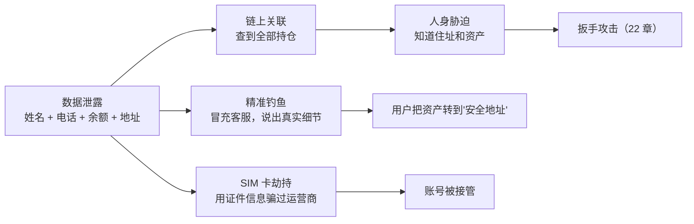

# 24 数据与隐私：泄露的数据会变成攻击

> 学习目标：读完本章，你能——
> 1. 说出 KYC 数据、客服工单、交易与余额记录三类数据泄露对用户的直接风险。
> 2. 解释链上去匿名化的常用方法，以及它对用户和攻击者的双重意义。
> 3. 为交易所数据访问设计最小权限、审计和外包管理。
>
> 前置章节：[21 社工与内部人](21-social-engineering-insiders.md)、[22 人身与账号安全](22-physical-account-security.md)
> 交互实验：[deanonymization-lab.html](../interactive/deanonymization-lab.html) ｜ [personal-risk-lab.html](../interactive/personal-risk-lab.html)

> 最后核对：2026-11-10

---

## 开场：不含密码的泄露

2025 年 5 月，犯罪团伙收买 Coinbase 的外包客服，导出 69,461 名用户的数据。数据不包含密码和私钥。Coinbase 仍估算这次事件要花费 1.8–4 亿美元。

<details class="predict"><summary>🤔 先猜再看：数据里没有密码，也没有私钥。攻击者怎样用它拿到用户的资产？</summary>

冒充客服。攻击者说出姓名、余额和交易记录，取得用户信任，再让用户自己把资产转到“安全钱包”。泄露的数据是诈骗的原料。

</details>

---

## 1. 一句话理解

**数据泄露是下一次诈骗的名单。攻击者拿到"谁持有多少资产、住在哪里、用哪个交易所"，就能冒充客服精准行骗，甚至找上门。**

个人数据（Personal Data）：可以识别一个人的信息，包括姓名、证件、住址、电话、邮箱。
去匿名化（De-anonymization）：把匿名的链上地址关联到真实身份。

> 🎯 打个比方：一份泄露的客户名单，等于给骗子发了一本"肥羊通讯录"。名单上写着姓名、电话、存款金额，还附上了"他上周刚联系过客服"。骗子打来电话时，说出的每一个细节都是真的。
>
> 比喻的局限：银行流水是私密的。链上交易是公开的。名单里只要有一个地址，攻击者就能查到这个人的全部链上历史和当前余额。

---

## 2. 威胁模型：攻击者能控制什么

| 数据类型 | 泄露途径 | 攻击者拿来做什么 |
|---|---|---|
| KYC 数据（姓名、证件、住址） | 外包客服被收买、第三方 KYC 服务商被入侵 | 冒充客服、身份盗用、人身威胁 |
| 客服工单（联系记录、问题描述） | 工单系统被入侵、第三方服务商员工 | 精准钓鱼："您上周的工单需要验证" |
| 交易与余额记录 | 内部查询被滥用、破产案债权人文件 | 筛选高价值目标 |
| 电商订单（硬件钱包购买记录） | 电商平台或营销数据库被入侵 | 知道谁持有硬件钱包，以及他的收货地址 |
| 邮箱与手机号 | 营销服务商、邮件服务商泄露 | 批量钓鱼、SIM 卡劫持的前期侦察 |



**读图要点：**

- 一次泄露会同时引发三类后续攻击：精准钓鱼、账号接管、人身风险。
- 泄露之后的损失通常远大于泄露本身。2025 年 Coinbase 事件中，公司估算的成本包括赔付被骗用户（见 5.2 节）。
- 局限：泄露的数据会长期流通。一份 2020 年泄露的名单，几年后仍被用于诈骗。

---

## 3. 攻击路径

### 3.1 内部人与外包

1. 攻击者在社交平台招募交易所的客服或外包人员，开价收买。
2. 被收买的员工在客服后台查询用户数据，截屏或导出。
3. 攻击者用这些数据冒充交易所客服，联系用户。
4. 攻击者说出用户的姓名、余额、最近的工单，取得信任。
5. 攻击者诱导用户把资产转到"安全钱包"。

### 3.2 第三方服务商

交易所的数据会流向很多第三方：KYC 服务商、客服工单系统、邮件营销、物流、法律和破产服务。每一家都是一个泄露点。

| 第三方类型 | 持有的数据 | 公开案例 |
|---|---|---|
| 电商与营销数据库 | 订单、收货地址 | Ledger（2020） |
| 客服工单系统 | 姓名、邮箱、问题描述 | Trezor（2024） |
| 邮件或营销服务商 | 邮箱、电话 | Gemini（2022） |
| 破产案服务商 | 姓名、地址、余额、持币明细 | Kroll（2023，FTX 等案债权人） |
| 外包客服 | KYC 全量、余额、交易记录 | Coinbase（2025） |

### 3.3 链上去匿名化

链上分析用公开数据把地址聚成"实体"，再把实体关联到真实身份。常用方法：

| 方法 | 原理 | 局限 |
|---|---|---|
| 共同输入所有权 | 一笔比特币交易的多个输入，大概率属于同一个所有者 | CoinJoin 等多方交易会打破这一假设 |
| 找零地址识别 | 识别交易中"找零"给自己的那个输出 | 启发式规则，有误判 |
| 交易所出入金 | 地址与交易所充值地址交互；交易所掌握 KYC | 需要交易所配合（执法调取） |
| 时间与金额关联 | 跨链、跨混币器的金额和时间模式 | 概率判断，需要其他证据佐证 |
| 链下关联 | ENS 名称、社交媒体发布的地址、NFT 头像 | 依赖用户自己暴露 |

<details class="predict"><summary>🤔 先猜再看：一笔交易有 4 个输入和 4 个金额相等的输出。共同输入规则把 4 个输入归为一个所有者。这个结论可靠吗？</summary>

不可靠。这是典型的 CoinJoin 特征：4 个不同的人可能各出一个输入。把它们聚在一起，会把一个人的 KYC 身份扩散到其他 3 个人。

</details>

> 🧪 动手验证：打开[链上去匿名化实验](../interactive/deanonymization-lab.html)，保持三条规则开启，点“揭示真相”，记录精确率。再勾选两条排除规则，把时间窗口调到 300 秒、金额容差调到 1%，记录精确率和召回率。

<details class="predict"><summary>🤔 先猜再看：OTC 商给两名不同客户的交易所充值地址各打过一笔款。“充值地址复用”规则会得出什么错误结论？</summary>

两个客户被连成同一实体。OTC 商的地址同时连到两个充值地址，聚类经由它合并了两个人。所以要排除已知的服务地址。

</details>

> 💡 注意：去匿名化是一把双刃剑。执法和交易所用它追踪被盗资金（见 [25 章](25-fund-tracing-response.md)）；攻击者用它筛选目标（见 [22 章](22-physical-account-security.md)）。

---

## 4. 防御方法

### 4.1 数据最小化

1. 只收集业务和合规必需的数据；明确每类数据的保存期限。
2. 客服后台默认遮蔽敏感字段：证件号、完整住址、完整余额。需要时逐条申请查看，并记录原因。
3. 客服只能查询当前工单对应的用户，不能任意搜索。
4. 导出功能默认关闭；开启需要审批，并有水印。

### 4.2 访问控制与审计

| 控制 | 做法 |
|---|---|
| 最小权限 | 按岗位授予数据访问权限，季度复核 |
| 查询审计 | 记录每一次敏感数据查询：谁、何时、查了谁、为什么 |
| 异常检测 | 单人查询量突增、查询与工单无关的用户、非工作时间查询，自动告警 |
| 反截屏 | 客服终端禁止截屏和外接存储；屏幕加隐形水印，便于追溯 |
| 设备管理 | 外包客服使用公司管理的设备和虚拟桌面 |

### 4.3 外包与第三方管理

1. 签约前做安全尽调：数据访问范围、员工背景调查、终端管理、审计日志。
2. 合同写明：数据用途、保存期限、泄露通知时限、审计权。
3. 只把最小必要的数据给第三方；能用令牌或脱敏数据的，不给原始数据。
4. 定期复核第三方清单；业务结束后确认数据已删除。

### 4.4 泄露后的处置

1. 确认泄露范围：哪些用户、哪些字段。
2. 按法规要求在时限内通知监管和用户。
3. 告诉用户攻击者可能会怎么联系他们，以及交易所**永远不会**做什么。
4. 对受影响用户加强风控：提币冷却、异常登录拦截。
5. 监控暗网和黑客论坛上的数据售卖信息。

> 🧪 动手验证：打开[关键人员风险自评](../interactive/personal-risk-lab.html)，岗位选“客服 / 外包主管”，把“住址是否出现在快递、注册信息或数据泄露中”分别答“没有”和“已确认”。记录“人身暴露”百分比的变化。

### 4.5 链上个人数据与删除权

链上数据很难删除。法律却要求在特定情形下删除个人数据。这个矛盾要在设计阶段解决。

> 💡 注意：本节是工程层面的整理，不是法律意见。上线前请法务按具体业务判断。

<details class="predict"><summary>🤔 先猜再看：合约只存 `keccak256(email)`，不存邮箱原文。用户要求删除数据，团队回答“链上只有哈希，不是个人数据”。这个回答成立吗？</summary>

不成立。邮箱的取值范围有限，攻击者可以枚举候选邮箱，计算哈希后比对。EDPB 认为不加盐、不带密钥的哈希在公链上通常不足以提供必要的保密性，哈希本身也算个人数据。

</details>

**EDPB 指南的现状。** EDPB 第 02/2025 号指南的 1.1 版于 2025 年 4 月 8 日通过，用于公开征求意见。**2.0 版于 2026 年 7 月 7 日通过，是征求意见后的版本。** 下面的段落号都引自 2.0 版。来源：[EDPB 指南 2.0 版（PDF）](https://www.edpb.europa.eu/system/files/2026-07/edpb_guidelines_202502_blockchain_v2_en.pdf)。

| 主题 | EDPB 的立场 | 段落 |
|---|---|---|
| 地址 | 如果公钥能用合理可能的手段识别自然人，它就是个人数据 | 26 |
| 明文上链 | 强烈不建议 | 35 |
| 技术不可行 | 不能作为不遵守 GDPR 的理由 | 50 |
| 链的选择 | 只有处理目的需要公开访问时才用公链；组织应优先选择许可链 | 40、49 |
| 加密 | 加密后的个人数据仍是个人数据；链长期保留时，加密算法终会过时 | 51 |
| 加盐或带密钥的哈希 | 哈希也算个人数据；不加盐、不带密钥的哈希在公链上通常不够 | 52 |
| 承诺 | 使用完美隐藏的承诺方案时，删除原始数据和见证后，链上承诺无法还原或识别原始数据 | 53 |
| 删除与反对 | 必须在设计时满足。要确保收到请求时，链上数据能被有效匿名化 | 102–103 |
| 更正 | 可以用后续交易声明取消，或按删除方案处理 | 106 |

**中国《个人信息保护法》。** 第四十七条规定了应当删除的情形。如果删除"从技术上难以实现"，处理者应当停止存储和必要安全保护之外的处理。这一条对"技术上难以实现"有明文安排，但不等于可以随意上链。来源：[全国人大网](http://www.npc.gov.cn/npc/c2/c30834/202108/t20210820_313088.html)。

**设计模式：**

| 模式 | 链上放什么 | 收到删除请求时 | 局限 |
|---|---|---|---|
| 链下存储 + 指针 | 随机标识符 | 删除链下记录和映射 | 链下系统仍受 GDPR 约束（第 52 段）；指针不能由用户数据派生 |
| 加盐承诺 | `H(salt ‖ data)`，盐是至少 256 位的随机数，每条记录一个 | 删除链下数据和盐 | 盐泄露或选取不当时可被比对；同一用户多条记录要用不同的盐 |
| 带密钥的 HMAC | `HMAC(key, data)` | 销毁对应密钥 | 密钥分组决定删除粒度；一把密钥覆盖多人时无法单独删除 |
| 加密上链后销毁密钥（Crypto-shredding） | 密文 | 销毁解密密钥 | 见下方警告 |
| 零知识证明 | 证明或承诺 | 删除证明的输入 | 第 56 段将其列为有帮助的增强技术，不是自动合规 |
| 不上链 | 无 | 按常规删除 | EDPB 建议：如果不需要区块链的强完整性，考虑其他工具（第 103 段） |

> ⚠️ 警告：密钥销毁不等于数据消失。
> 1. 密文还在每个节点、归档节点和索引器里。
> 2. 如果密钥此前泄露过，销毁不起作用。
> 3. 算法被破解后，历史密文可被解密。公链的保留期没有上限。
> 4. EDPB 明确说明，加密后的数据仍是个人数据。

```solidity
// ❌ 漏洞：邮箱取值空间小，可以枚举比对
// 任何人可用常见邮箱逐个计算哈希比对
bytes32 id = keccak256(abi.encodePacked(email));

// ✅ 修复：链上只存承诺；salt 是链下生成的 32 字节随机数，与原文一起存在可删除的系统里
// 无 salt 无法枚举；删除 salt 后承诺无法再关联到个人
bytes32 commitment = keccak256(abi.encodePacked(salt, canonicalRecord));
```

> 💡 注意：哈希承诺提供的是计算隐藏，不是第 53 段说的完美隐藏。Pedersen 这类方案才是完美隐藏。选型要写进 DPIA（数据保护影响评估）。

删除还要覆盖链外的副本。第 64 段要求防止用合理可能的手段，把现存交易与同一主体的未来交易关联。所以删除映射后，还要检查：

1. 日志、数据仓库、备份、风控模型里的地址到身份映射。
2. 交给链上分析服务商的标签数据。
3. 合约事件是否写入了可识别的字段。
4. 合规要求必须保留的 KYC 记录，要写明保留依据和到期时间。

---

## 5. 真实案例

> 💡 注意：以下每个案例只写摘要和教训。金额为事发时美元估值。

### 5.1 Ledger 客户数据泄露（2020 年）

- 2020 年 6 月，攻击者利用第三方的 API Key 访问了 Ledger 的电商与营销数据库。
- 泄露约 100 万个邮箱，以及约 27.2 万条姓名、住址、电话（Ledger 后来修正为约 29.2 万名客户）。12 月，完整数据库被公开在黑客论坛。
- 之后出现大量钓鱼邮件和短信，以及针对客户的电话和邮件威胁。
- 教训：硬件钱包本身没有被攻破，但"谁买了硬件钱包、寄到哪里"本身就是高价值数据。
- 来源：[Ledger CEO 声明](https://www.ledger.com/message-ledgers-ceo-data-leak)、[Ledger 后续说明](https://www.ledger.com/blog/update-efforts-to-protect-your-data-and-prosecute-the-scammers)、[SiliconANGLE](https://siliconangle.com/2020/12/21/data-stolen-cryptocurrency-wallet-provider-ledger-published-hacking-site/)

### 5.2 Coinbase 外包客服泄露（2025 年 5 月）

- 犯罪团伙收买美国境外的外包客服，从客服工具中导出 69,461 名用户的数据：姓名、联系方式、证件图像、社保号后四位、部分遮蔽的银行账号、余额和交易记录。不涉及密码和私钥。
- 攻击者索要 2,000 万美元。Coinbase 拒付，设立同等金额的悬赏，并承诺赔偿被冒充客服骗走资金的用户。公司在 SEC 8-K 文件中估算成本约 1.8–4 亿美元。
- 外包商解雇了涉事员工并关闭了相关业务线。2025 年 12 月，印度警方逮捕一名前客服。
- 同一时期，纽约布鲁克林检方起诉一名冒充 Coinbase 客服、骗走约 1,600 万美元的人，他 2026 年被判刑。公开材料**没有**证明他使用了这次泄露的数据，二者不能写成因果。
- 教训：客服后台是交易所数据最集中的出口。遮蔽、审计、异常检测缺一不可。
- 来源：[Coinbase SEC 8-K](https://www.sec.gov/Archives/edgar/data/1679788/000167978825000094/coin-20250514.htm)、[The Record（引用州备案与 SEC 8-K）](https://therecord.media/nearly-70000-impacted-coinbase-breach)、[TechCrunch（引用缅因州备案）](https://techcrunch.com/2025/05/21/coinbase-says-its-data-breach-affects-at-least-69000-customers/)、[Help Net Security](https://www.helpnetsecurity.com/2025/05/15/coinbase-suffers-data-breach-gets-extorted/)、[资损 101](../../web3-loss-101/index.html#c-coinbase25)

### 5.3 第三方服务商泄露（2022–2024）

- **Kroll（2023 年 8 月）**：Kroll 一名员工的手机号被 SIM 卡劫持，攻击者访问了 FTX、BlockFi、Genesis 三个破产案的债权人文件，包括姓名、地址、邮箱和账户余额。之后出现针对债权人的钓鱼。教训：外包商员工的手机号也是你的攻击面；余额数据就是"肥羊名单"。来源：[BleepingComputer](https://www.bleepingcomputer.com/news/security/kroll-reveals-ftx-customer-info-exposed-in-august-data-breach/)、[Help Net Security](https://www.helpnetsecurity.com/2023/08/28/kroll-sim-swapping-attack/)。
- **Trezor（2024 年 1 月）**：第三方客服工单平台被未授权访问，最多约 6.6 万名联系过客服的用户的邮箱和姓名泄露。冒充者随后联系约 40 名用户，索要助记词。来源：[Trezor 官方博客](https://blog.trezor.io/trezor-security-update-stay-vigilant-against-potential-phishing-attack-bb05015a21f8)、[Cointelegraph](https://cointelegraph.com/news/trezor-discloses-66k-users-affected-phishing-attack)。
- **Gemini（2022 年 12 月）**：一家第三方供应商被入侵，约 570 万行客户邮箱和部分遮蔽的电话号码泄露。Gemini 称账户和系统未受影响。来源：[The Block](https://www.theblock.co/post/195083/)、[Cointelegraph](https://cointelegraph.com/news/gemini-allegedly-suffers-data-breach-5-7-million-emails-leaked)。
- 教训：你的数据安全取决于你数据流向的最弱的那家第三方。

### 5.4 链上分析进入法庭（2024 年，Bitcoin Fog）

- Roman Sterlingov 被认定在 2011–2021 年运营混币器 Bitcoin Fog，经手 120 万余枚 BTC。2024 年 3 月陪审团裁定四项罪名成立，11 月被判 12.5 年。
- 法官经过专门的证据可采性听证，认定 Chainalysis Reactor 的分析可以作为证据，同时有卧底交易等其他证据印证。辩方质疑该工具闭源、无法复核。
- 2026 年 9 月 25 日，美国哥伦比亚特区巡回上诉法院维持定罪和 150 个月刑期。法院认可了基于 Reactor 的专家证言；Reactor 的启发式规则和假设已在保护令下向律师和专家开放，法院没有要求披露源代码。
- 教训：混币和地址轮换不等于匿名。交易所的出入金记录，往往是把地址落到真人身上的关键一环。
- 来源：[IRS-CI 新闻稿](https://www.irs.gov/node/140406)、[Fortune](https://fortune.com/crypto/2024/03/13/blockchain-analysis-chainalysis-bitcoin-fog-law-enforcement/)、[CryptoSlate（上诉判决）](https://cryptoslate.com/bitcoin-fog-appeal-upheld-wallet-tracing-without-requiring-its-source-code/)、[MLex](https://www.mlex.com/mlex/financial-crime/articles/2530292)

---

## 6. 评估检查点

- [ ] **DAT-1** 有数据清单：每类个人数据存放在哪里、谁能访问、保存多久。
- [ ] **DAT-2** 客服后台默认遮蔽敏感字段；查看完整字段需要逐条申请并记录原因。
- [ ] **DAT-3** 客服只能查询当前工单对应的用户。
- [ ] **DAT-4** 敏感数据查询全部留痕；有异常查询告警。
- [ ] **DAT-5** 导出默认关闭；客服终端禁止截屏和外接存储，屏幕有水印。
- [ ] **DAT-6** 外包客服使用公司管理的设备或虚拟桌面。
- [ ] **DAT-7** 第三方服务商有安全尽调、合同约束和定期复核；有第三方清单。
- [ ] **DAT-8** 有数据泄露应急预案：范围确认、法定通知、用户提示、风控加强。
- [ ] **DAT-9** 监控暗网和论坛上的数据售卖信息。
- [ ] **DAT-10** 合约字段和事件中没有明文个人数据，也没有不加盐、不带密钥的个人数据哈希。
- [ ] **DAT-11** 上链方案有 DPIA，写明为什么需要区块链、为什么选这种链，以及个人数据的存放位置。
- [ ] **DAT-12** 有删除请求流程，覆盖链下数据、盐或密钥、日志、备份、数据仓库和第三方标签。
- [ ] **DAT-13** 盐和密钥的粒度能按单个用户删除；销毁操作有记录；已评估长期算法风险。


**把检查结果写进报告：**

| 检查项 | 发现时的证据 | 常见定级（用 [A02](../assessment/A02-risk-rating-reporting.md) 复核） | 练习位置 |
|---|---|---|---|
| DAT-1 | 数据清单：字段、位置、访问者、保存期限 | Medium | [T06](../templates/T06-ops-security-self-check.md) |
| DAT-2、DAT-3、DAT-4 | 客服后台的遮蔽配置、查询范围、审计日志和告警样例 | High（可批量查询用户时） | [21 章](21-social-engineering-insiders.md)、[A06](../assessment/A06-operational-key-security.md) |
| DAT-5、DAT-6 | 导出审批、终端策略、虚拟桌面配置 | High / Medium | [A06 运营与密钥安全](../assessment/A06-operational-key-security.md) |
| DAT-7 | 第三方清单、尽调报告、合同条款 | High / Medium | [A03](../assessment/A03-exchange-contracts-wallets.md) |
| DAT-8、DAT-9 | 预案、演练记录、监控命中记录 | Medium | [25 章](25-fund-tracing-response.md)、[链上去匿名化实验](../interactive/deanonymization-lab.html) |
| DAT-10 | 合约存储和事件的字段清单；枚举比对测试结果 | High（可恢复身份时） | [30 章](30-enterprise-blockchain-security.md) |
| DAT-11 | DPIA、选链理由、数据流图 | Medium | [T06](../templates/T06-ops-security-self-check.md) |
| DAT-12、DAT-13 | 删除工单样例、密钥粒度设计、销毁记录、第三方确认 | High / Medium | [A06](../assessment/A06-operational-key-security.md) |

发现按 [T03 报告模板](../templates/T03-finding-report.md) 记录。报告里不写真实用户数据，只写字段名和数量。

---

## 7. 用户侧防护

1. 交易所和钱包厂商**永远不会**要求你把资产转到"安全地址"，也不会索要助记词。
2. 对方能说出你的姓名、余额、工单内容，**不代表**他是真客服。数据可能已经泄露。
3. 主动来电、短信、邮件说你的账户有风险，一律挂断，再从官方 App 内联系客服。
4. 购买硬件钱包使用代收地址；在交易所和电商使用不同的邮箱。
5. 不在社交媒体公开自己的地址或 ENS 名称与真实身份的关联。
6. 收到交易所的泄露通知后，开启提币白名单，提高警惕至少几个月。

---

## 8. 术语表

| 术语 | 英文 | 定义 |
|---|---|---|
| 个人数据 | Personal Data | 可以识别一个人的信息 |
| KYC | Know Your Customer | 金融机构对客户身份的核验 |
| 数据最小化 | Data Minimization | 只收集和保存必需的数据 |
| 字段遮蔽 | Data Masking | 默认隐藏敏感字段的部分或全部内容 |
| 去匿名化 | De-anonymization | 把匿名的链上地址关联到真实身份 |
| 地址聚类 | Address Clustering | 用启发式规则把多个地址归为同一实体 |
| 共同输入所有权 | Common-Input-Ownership Heuristic | 同一笔交易的多个输入被视为属于同一所有者 |
| 第三方风险 | Third-Party Risk | 来自供应商和外包方的安全风险 |
| 删除权 | Right to Erasure | 个人在特定情形下要求删除其数据的权利（GDPR 第 17 条） |
| 承诺 | Commitment | 绑定一个值、但不泄露这个值的密码学结构 |
| 盐 | Salt | 与原文一起输入哈希的随机值，用于抵抗枚举 |
| 密钥销毁 | Crypto-shredding | 删除解密密钥，让密文无法被读取 |
| 数据保护影响评估 | DPIA | 高风险数据处理前的书面风险评估 |

---

> 🪞 反思：选一类你的系统保存的用户数据。
> 1. 今天有多少人能查到一条完整记录？他们为什么需要？
> 2. 如果这些数据明天被公开，你要告诉用户哪三件事？
> 3. 你用启发式规则关联过地址吗？结论被当成事实使用了吗？

## 9. 思考题

1. 你的交易所有 300 名外包客服。按本章第 4 节，列出 5 项可以在一个月内上线的控制，并按效果排序。
2. 一个用户说："我只在交易所做过 KYC，从没公开过自己的地址，为什么骗子知道我有多少币？"列出至少三种可能。
3. 链上去匿名化对普通用户是威胁，对追回被盗资金是工具。交易所应该如何平衡这两者？

下一章：[25 资金追踪、冻结与事后处置](25-fund-tracing-response.md) —— 钱被转走之后。
