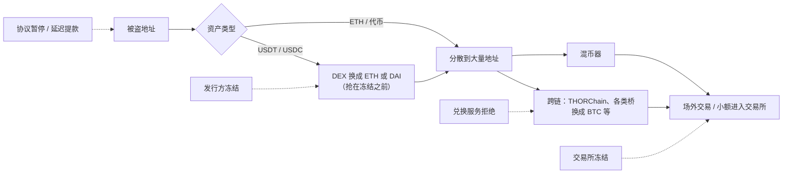
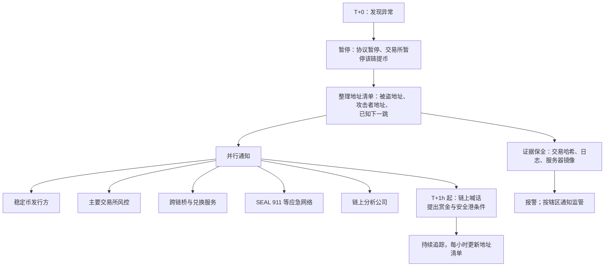

# 25 资金追踪、冻结与事后处置：钱被转走之后

> 学习目标：读完本章，你能——
> 1. 用链上追踪的基本方法跟踪一笔被盗资金经过跨链桥、混币器和交易所的路径。
> 2. 说出稳定币发行方冻结、交易所冻结、链级冻结、谈判赎回、执法协作五条追回路径的条件与时效。
> 3. 搭建链上监控与威胁情报共享的基本能力。
>
> 前置章节：[A09 应急响应](../assessment/A09-incident-response.md)、[23 托管、充提与合规安全](23-custody-exchange-ops.md)
> 交互实验：[incident-explorer.html](../interactive/incident-explorer.html)、[incident-response-sim.html](../interactive/incident-response-sim.html)

> 最后核对：2026-11-09
---

## 开场：37 分钟之后

2026 年 10 月 29 日，Tether 在 Binance 主要清扫交易之后 37 分钟冻结了 9.711 亿 USDT。Circle 3 分钟后冻结了 8.23 亿 USDC。Elliptic 估计，冻结生效前，约 7.86 亿美元稳定币已被换成 ETH 和 TRX。

🤔 先猜再看：被盗资产包括 USDT、USDC、BTC、XRP 和 SOL。发行方冻结能覆盖哪些资产？

只有发行方能够控制的代币，例如 USDT、USDC。BTC、XRP、SOL 等原生资产没有发行方。所以第一批通知发给发行方，但不能把发行方冻结当作全部追回方案。

---

## 1. 一句话理解

**追回的窗口以小时计。被盗资金在头几个小时里还是"可冻结的稳定币""交易所里的充值""链上可暂停的合约份额"。几个小时之后，它们会变成跨链后的原生币、混币器里的存款，或者场外交易的现金。**

资金追踪（Fund Tracing）：沿着链上交易，跟踪被盗资金的去向。
冻结（Freeze）：由发行方、交易所或链上机制阻止某个地址转出资产。

> 🎯 打个比方：抢劫发生后，警方在城市的每个出口设卡。出口是稳定币发行方、交易所、跨链桥、混币器。设卡越早，拦住的车越多。劫匪的车一旦开上国道、换了车牌（跨链、换币），再拦就很难了。
>
> 比喻的局限：链上的"出口"大多不归任何警察管。去中心化的跨链桥、混币器、去中心化交易所没有义务配合。所以能拦住的，主要是有中心化运营方的那部分出口。

---

## 2. 威胁模型：攻击者能控制什么

| 攻击者的动作 | 目的 | 防守方的机会 |
|---|---|---|
| 把稳定币换成 ETH / BTC | 躲开发行方冻结 | 换币前，稳定币发行方冻结 |
| 跨链（例如 THORChain、各类桥） | 离开被监控的链 | 有运营方的桥和兑换服务可以拦截 |
| 进入混币器 | 切断链上关联 | 监控混币器的提款地址 |
| 分散到大量地址 | 增加追踪成本 | 自动化聚类工具 |
| 小额分批进入交易所 | 变现 | 交易所风控名单和冻结 |
| 等待 | 等关注度下降 | 长期监控已标记地址 |

---

## 3. 攻击路径：被盗资金的典型流向

**读图要点：**

- 拦截点越靠左，成功率越高。被盗地址里的资产如果还在一个可暂停的协议里，协议方暂停就能保住它。
- 攻击者的第一步常常是把稳定币换掉。所以发行方冻结要以分钟计。
- 2025 年 Bybit 事件中，约 72% 的资金经 THORChain 换成 BTC，约 16% 经 eXch 兑换（见 5.3 节）。
- 局限：图里的拦截点都需要有人在第一时间提供准确的地址清单。

---

## 4. 防御方法：五条追回路径

### 4.1 路径对比

| 路径 | 谁来执行 | 条件 | 时效 | 局限 |
|---|---|---|---|---|
| 协议暂停 / 延迟提款 | 协议方 | 合约有暂停或延迟机制，且有人值守 | 分钟级 | 必须提前设计 |
| 稳定币发行方冻结 | Tether、Circle 等 | 执法请求或法院命令；发行方自身政策 | 分钟到小时 | 有门槛和时延；可能被法院撤销 |
| 交易所冻结 | 中心化交易所 | 收到可信的地址清单；风控名单命中 | 小时级 | 攻击者会避开合规交易所 |
| 链级冻结 | 验证者 / 治理 | 链的验证者集合小、能协调 | 小时到天 | 损害链的中立性，存在争议 |
| 谈判与白帽赎回 | 受害方与攻击者 | 攻击者愿意沟通；赏金有吸引力 | 天到周 | 结果不可控 |
| 执法与司法 | 警方、法院 | 证据保全、跨境协作 | 月到年 | 返还周期长、结果不确定 |

### 4.2 事发后的前 6 小时

**读图要点：**

- "整理地址清单"是所有通知的前提。清单不准，冻结请求就会被拒绝或延误。
- 通知是并行的，不是排队的。
- 证据保全要在清理和恢复系统之前完成。恢复系统会覆盖证据。
- 暂停提现只是链下动作。已有的链上授权要单独撤销，见 [29 章](29-signing-path-2026.md) 4.9 节。
- 局限：这张图是交易所或协议方的视角。个人用户的版本见第 7 节。

> 🧪 动手验证：打开[热钱包应急演练](../interactive/incident-response-sim.html)，在"⑤ 发行方冻结"分别选择"立即向多家发行方并行发送地址清单"和"等完整调查结论后统一发送"。比较复盘页的"已冻结"和"最终损失"。模型数字只用于比较。

### 4.3 链上监控与威胁情报

| 能力 | 做法 |
|---|---|
| 实时检测 | 监控大额流出、权限变更、合约升级、价格异常；接入链上监控工具 |
| 自动响应 | 检测到预设模式时，自动暂停协议或该链提币（需要事先授权，并有误报处理流程） |
| 风控名单 | 接入公开的被盗地址、制裁地址、Drainer 地址；每日更新 |
| 情报共享 | 加入行业情报共享渠道；事发时第一时间发布地址清单 |
| 演练 | 每季度一次应急演练，覆盖通知清单和联系人是否有效 |

🤔 先猜再看：攻击者刚把 USDC 转到一个新地址。你是先写完整的事故报告，还是先发地址清单？

先发地址清单。冻结请求只需要准确的地址和交易哈希。完整报告可以后补。攻击者的第一步常常是换掉稳定币，窗口以分钟计。

### 4.4 安全港与白帽

- **SEAL 911**：Security Alliance 运营的应急渠道（Telegram 机器人），把正在遭受攻击的受害方对接给经过审查的安全研究者。
- **SEAL Whitehat Safe Harbor（2024）**：协议通过治理事先授权白帽，在攻击正在发生时抢救资金。默认条款：72 小时内把资金返还到指定地址，赏金为 10%、上限 100 万美元，协议可以调整。只适用于正在发生的攻击，不保护黑帽。
- 教训：赏金和授权要事先写进治理。事发时再讨论，白帽不敢动手。
- 来源：[SEAL 911](https://securityalliance.org/seal-911)、[Safe Harbor 框架](https://frameworks.securityalliance.org/safe-harbor)、[Lido 采纳说明](https://docs.lido.fi/security/safeharbor)

---

## 5. 真实案例

> 💡 注意：以下每个案例只写摘要和教训。完整复盘见《[Web3 行业安全资损 101](../../web3-loss-101/index.html)》。金额为事发时美元估值。

### 5.1 谈判归还：Poly Network（2021 年 8 月）与 Euler（2023 年 3 月）

- **Poly Network**：跨链管理合约的权限缺陷被利用，约 6.1 亿美元被盗（见 [12 章](12-cross-chain-bridges.md)）。攻击者自称"白帽"，约 15 天内归还。Tether 冻结了约 3,300 万美元 USDT。攻击者拒绝了 50 万美元赏金。来源：[Poly Network 复盘](https://medium.com/poly-network/honour-exploit-and-code-how-we-lost-610m-dollar-and-got-it-back-c4a7d0606267)、[CertiK](https://www.certik.com/resources/blog/poly-network-exploit)、[资损 101](https://claude.ai/artifact/1a5Nx6xTVLuJdCB8Esf2xj#c-poly)。
- **Euler Finance**：约 1.97 亿美元被闪电贷攻击。Euler 先提出 10% 赏金，同时宣布另设 100 万美元悬赏征集攻击者线索。约一周后攻击者开始归还；4 月初 Euler 宣布全部可追回资金已归还。来源：[The Block](https://www.theblock.co/post/224705/euler-hacker-returns-funds)、[Cointelegraph](https://cointelegraph.com/news/euler-labs-hacker-returns-all-of-the-recoverable-funds-timeline)、[资损 101](https://claude.ai/artifact/1a5Nx6xTVLuJdCB8Esf2xj#c-euler)。
- 教训：链上喊话、赏金和执法威慑一起使用，有时能促成归还。但攻击者归还的真正原因通常不公开，不能把谈判当作预案的主线。

### 5.2 链级冻结：Cetus（2025 年 5 月，Sui）

- Cetus 的集中流动性合约有算术溢出漏洞，约 2.23 亿美元被盗。约 6,300 万美元在冻结前跨链到以太坊。
- Sui 验证者在链上冻结了约 1.62 亿美元。治理投票以约 90.9% 的质押权通过，通过协议升级把冻结资金转入三方共管的多签，用于赔付。
- 争议：验证者能冻结并改写特定地址的状态，引发对链的中立性的质疑，部分验证者公开表达保留意见。
- 教训：链级冻结能救急，但也说明这条链的验证者可以干预任意地址。交易所和机构应把"链能做到的干预程度"纳入风险评估，见 [16 章](16-consensus-chain-security.md)。
- 来源：[The Block](https://www.theblock.co/post/356347/)、[Cointelegraph](https://cointelegraph.com/news/sui-validators-freeze-majority-stolen-funds-220m-cetus-hack)、[Chainflow 声明](https://chainflow.io/chainflows-official-response-to-the-cetus-exploit-and-sui-governance-vote/)、[资损 101](../../web3-loss-101/index.html#c-cetus)

### 5.3 大规模追踪：Bybit 之后（2025 年 2 月起）

- FBI 在事发后 5 天发布公告，归因于朝鲜 TraderTraitor，公布攻击者地址，呼吁全行业拦截。来源：[FBI 公告](https://www.ic3.gov/psa/2025/psa250226)。完整复盘见[资损 101](https://claude.ai/artifact/1a5Nx6xTVLuJdCB8Esf2xj#c-bybit)。
- 资金流向：约 72% 经 THORChain 换成 BTC；约 16% 经兑换服务 eXch 兑换，eXch 之后于 2025 年 5 月关停。
- mETH Protocol 依靠 8 小时的提款延迟，暂停合约，追回约 4,300 万美元的 cmETH。来源：[The Block](https://www.theblock.co/post/342840/)。
- Bybit 上线悬赏网站，按追回金额的 10% 支付赏金。2025 年 4 月口径：约 68.6% 可追踪，约 27.6% 已无法追踪，约 3.8% 被冻结。来源：[The Block](https://www.theblock.co/post/351344/)。
- 2026 年 8 月，Bybit 在美国联邦法院起诉朝鲜相关方，获得资产冻结禁令。Bybit 自报累计追回加冻结约占被盗额的 5%。来源：[Decrypt](https://decrypt.co/375180/)。
- 教训：
  - 协议层的延迟提款和暂停能力，比事后冻结有效得多。mETH 是这次事件中追回最多的单项。
  - 即使全行业协作，几周后大部分资金也已无法追踪。

### 5.4 稳定币发行方冻结（2024–2026）

- **Tether T3 金融犯罪部门**：2024 年 9 月由 Tether、TRON、TRM 联合成立。2026 年 5 月宣布累计冻结 4.5 亿美元以上（自报）。来源：[The Block](https://www.theblock.co/post/401252/)、[TRM](https://www.trmlabs.com/resources/blog/t3-financial-crime-unit-marks-enforcement-victory-100-million-in-criminal-assets-frozen-across-five-continents)。
- **Circle 与 LIBRA 案**：Circle 依据纽约南区法院 2025 年 5 月的临时限制令冻结约 5,760 万美元 USDC；2025 年 8 月法官解除冻结，理由是原告未证明不可弥补的损害。来源：[Cointelegraph（冻结）](https://cointelegraph.com/news/us-court-freezes-57-million-libra-memecoin-case)、[Cointelegraph（解冻）](https://cointelegraph.com/news/judge-unfreezes-over-57m-stablecoins-libra-token-scandal)。
- **对冻结速度的批评**：2026 年 4 月，链上调查者 ZachXBT 公开批评 Circle 在 Drift 被盗事件中延迟约 6 小时，期间约 2.32 亿美元经跨链协议转走。这是个人指控，本书未见 Circle 回应。来源：[The Block](https://www.theblock.co/post/396296/)。
- **Binance 事件的冻结（2026 年 10 月）**：除开场所述的两次发行方冻结外，事发后约 4 小时累计冻结约 27 亿美元（TRM 口径）。Arbitrum 安全委员会强制转走攻击者钱包中的 8,426 ETH 和 7,460 万 ARB。冻结前的兑换折价 12%–26%（Elliptic）。来源：[TRM](https://www.trmlabs.com/resources/blog/north-korea-steals-usd-6-36-billion-from-binance-in-the-largest-hack-in-history)、[Elliptic](https://www.elliptic.co/insights/binance-largest-hack-in-history/)、[资损 101](https://claude.ai/artifact/1a5Nx6xTVLuJdCB8Esf2xj#c-binance)。
- **法规**：美国 GENIUS 法案（2025 年 7 月成为法律）要求支付型稳定币发行方具备执行合法命令的技术能力，包括冻结、扣押、阻止转账。来源：[法律原文](https://www.congress.gov/119/plaws/publ27/PLAW-119publ27.htm)、[Covington 解读](https://www.cov.com/news-and-insights/insights/2025/07/the-genius-act-becomes-law-key-provisions-from-the-federal-stablecoin-regulatory-framework)。
- 教训：发行方冻结有门槛、有时延，也可能被撤销。它是重要的工具，但不是兜底。Binance 事件中，冻结只覆盖了约 44% 的损失，BTC、XRP、SOL 等原生资产不受发行方控制。

### 5.5 执法追回：Bitfinex 2016 年被盗资金（2022 年没收）

- 2022 年 2 月，美国司法部逮捕两名嫌疑人。调查人员解密了云存储中的私钥文件，没收约 94,636 BTC（当时约 36 亿美元），是当时最大的一次加密资产没收。两人 2023 年认罪。
- 2025 年 1 月，检方申请把约 94,643 BTC 以实物返还 Bitfinex。法官对返还方式提出质疑。最终处置截至本书核查时仍有争议。
- 教训：从执法追回到真正返还，可能要拖好几年。证据保全和长期跟进是追回的前提。
- 来源：[美国司法部（逮捕）](https://www.justice.gov/archives/opa/pr/two-arrested-alleged-conspiracy-launder-45-billion-stolen-cryptocurrency)、[美国司法部华盛顿特区检察署案件页](https://www.justice.gov/usao-dc/2016-bitfinex-hack)、[The Block（实物返还申请）](https://www.theblock.co/post/334791/)、[Cointelegraph（法官质疑）](https://cointelegraph.com/news/judge-improper-order-funds-returned-bitfinex-hack)

---

## 6. 评估检查点

- [ ] **TRC-1** 协议有暂停能力，暂停权限有 24 小时值守，见 [T04 上线门禁](../templates/T04-go-live-gate.md)。
- [ ] **TRC-2** 大额提款有延迟机制或速率限制。
- [ ] **TRC-3** 有事发通知清单：稳定币发行方、主要交易所、跨链桥、应急网络、链上分析公司、执法；每季度验证联系人有效。
- [ ] **TRC-4** 有地址清单模板，事发 1 小时内可以发出第一版。
- [ ] **TRC-5** 有证据保全流程：先保全，后恢复。
- [ ] **TRC-6** 协议已采纳安全港协议，或在治理中事先定义赏金和白帽授权。
- [ ] **TRC-7** 有实时链上监控和自动响应；误报处理流程已演练。
- [ ] **TRC-8** 交易所侧：收到冻结请求后有 24 小时值守人员处理；风控名单每日更新。
- [ ] **TRC-9** 每季度一次应急演练，演练报告留档。
- [ ] **TRC-10** 聚类等启发式追踪结论都标注规则、参数和置信度；不单独作为冻结或拒绝服务的依据。

**把检查结果写进报告：**

| 检查项 | 发现时的证据 | 常见定级（用 [A02](../assessment/A02-risk-rating-reporting.md) 复核） | 练习位置 |
|---|---|---|---|
| TRC-1、TRC-2 | 暂停权限配置；延迟参数；值守记录 | 高 | [A04](../assessment/A04-defi-protocol-review.md)、[T04](../templates/T04-go-live-gate.md) |
| TRC-3、TRC-4 | 联系人验证记录；地址清单模板 | 中 / 高 | [热钱包应急演练](../interactive/incident-response-sim.html) ⑤ |
| TRC-5 | 证据保全流程；演练留档 | 高 / 中 | [热钱包应急演练](../interactive/incident-response-sim.html) ⑦ |
| TRC-6 | 治理提案或安全港条款 | 中 | 本章 4.4 节 |
| TRC-7 | 监控规则；误报处理记录 | 高 / 中 | [29 章](29-signing-path-2026.md) SIG-17 |
| TRC-8 | 值守排班；风控名单更新记录 | 中 | [23 章](23-custody-exchange-ops.md) |
| TRC-9 | 季度演练报告 | 中 | [A09](../assessment/A09-incident-response.md) |
| TRC-10 | 追踪结论记录表（规则、参数、置信度、人工复核人） | 中 | [去匿名化实验](../interactive/deanonymization-lab.html)、[B67](../bootcamp/B67-privacy-compliance-practice.md) 第 1 步 |

发现按 [T03 报告模板](../templates/T03-finding-report.md) 记录。交易所对象的评估范围见 [A03](../assessment/A03-exchange-contracts-wallets.md)。

---

## 7. 用户侧防护

如果你的资产被盗：

1. 立刻撤销所有授权，把剩余资产转到一个**全新**的地址（新助记词、新设备）。
2. 记录：被盗地址、攻击者地址、交易哈希、时间、你点过的链接或文件。
3. 如果被盗的是 USDT / USDC，立刻联系发行方，并说明交易哈希。
4. 如果资金流向某个交易所，通过该交易所的官方渠道提交冻结请求。
5. 报警，取得报案回执。交易所和发行方通常需要执法请求才能冻结。
6. 联系可信的应急网络（例如 SEAL 911）。
7. **警惕"追回诈骗"**：声称能帮你追回资金、要你先付费的人，几乎都是诈骗。

---

## 8. 术语表

| 术语 | 英文 | 定义 |
|---|---|---|
| 资金追踪 | Fund Tracing | 沿着链上交易跟踪资金去向 |
| 冻结 | Freeze | 阻止某个地址转出资产 |
| 发行方冻结 | Issuer Freeze | 稳定币发行方在合约层面冻结某个地址 |
| 链级冻结 | Chain-level Freeze | 验证者或治理在链层面阻止某个地址的交易 |
| 安全港 | Safe Harbor | 事先授权白帽在攻击中抢救资金并约定赏金的协议 |
| 白帽赎回 | Whitehat Rescue | 安全研究者抢先转走受威胁的资金并归还 |
| 证据保全 | Evidence Preservation | 在恢复系统前保存日志、镜像和交易记录 |
| 威胁情报 | Threat Intelligence | 关于攻击者、地址、手法的共享信息 |
| 追回诈骗 | Recovery Scam | 冒充能追回资金、骗取受害者费用的诈骗 |

---

> 🪞 反思：假设今晚你的系统有资金被转走。
> 1. 第一份地址清单由谁整理？他现在有发行方的联系方式吗？
> 2. 恢复系统之前，谁负责确认证据已经保全？
> 3. 哪些资产一旦转走，没有任何一方能帮你冻结？

## 9. 思考题

1. 被盗资金中有 1,000 万美元 USDC、2,000 万美元 ETH、500 万美元某协议的质押份额。按本章 4.1 节，你会按什么顺序处理？为什么？
2. Cetus 事件中的链级冻结，从用户角度是好事还是坏事？如果你是交易所的上币评估人，这件事会让你给 Sui 的评分升高还是降低？
3. 打开 [incident-explorer.html](../interactive/incident-explorer.html)，找出资金被全部或大部分归还的事件。它们有什么共同点？

下一章：[26 AI 与 Web3 安全](26-ai-web3-security.md) —— AI 同时站在攻防两边。
