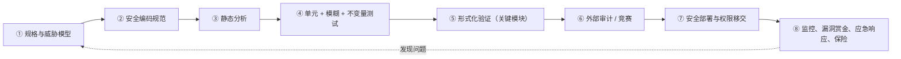

# 27 审计、测试与开发流程：把安全写进流水线

> 学习目标：读完本章，你能——
> 1. 画出合约从设计到上线后监控的 8 个安全关口。
> 2. 用 Foundry 写出一个模糊测试和一个不变量测试。
> 3. 为部署到 BNB Chain、TRON、Mantle 的合约分别准备链特定的测试项。
>
> 前置章节：01–12 章
> 交互实验：[chain-porting-lab.html](../interactive/chain-porting-lab.html)、[incident-explorer.html](../interactive/incident-explorer.html)
>
> 最后核对：2026-11-09

---

## 开场：审计过的，也被打穿了

2021 年 5 月，PancakeBunny 被攻击，损失约 4,500 万美元。审计方事后说明，被利用的是审计之后才上线的版本（[C01](../chains/C01-bnb-chain.md) 4.2 节）。

<details class="predict"><summary>🤔 先猜再看：项目方能否用"我们通过了审计"证明当前线上代码安全？</summary>

不能。审计结论只对审计时的提交哈希成立。还要证明线上字节码等于审计版本，并且上线后的改动都经过审查。

</details>

---

## 1. 一句话理解

**审计不是安全的起点，也不是终点。审计是流水线上的一个关口；它之前要有设计和测试，它之后要有监控和应急。**

> 🎯 打个比方：合约开发像造一架飞机。
>
> - 设计阶段：画图纸，并写出"任何情况下机翼不能断"（不变量）。
> - 制造阶段：每个零件出厂前都测（单元测试），并把零件放进风洞里用各种极端风向吹（模糊测试）。
> - 适航认证：外部机构检查（审计）。认证不检查每一颗螺丝，只抽查关键系统。
> - 投入运营：飞行中有黑匣子和地面雷达（监控），出了问题有应急程序（暂停、响应）。
>
> 比喻的局限：飞机出厂后可以召回维修。不可升级的合约出厂后就不能改了，所以前面的关口必须更严。

---

## 2. 八个安全关口



**读图要点：**

- 越靠左的关口，修复成本越低。规格阶段发现的问题，只需要改文档。
- ③④⑤ 是自动化关口，每次提交代码都应运行。
- ⑥ 审计发现的问题，应该反向补充到 ④ 的测试中，防止回归。
- 局限：所有关口都依赖"你想到了要检查什么"。经济攻击和跨协议组合风险，常常需要专门的经济审计。

---

## 3. 各关口要做什么

### 3.1 规格与威胁模型

1. 写出每个函数的前置条件、后置条件。
2. 写出系统不变量（[01 章](01-security-landscape.md) 4.2 节）。
3. 列出外部依赖：代币、预言机、DEX、跨链桥、目标链特性。
4. 列出特权角色和每个角色的最大破坏力。

### 3.2 静态分析

| 工具 | 类型 | 能发现什么 |
|---|---|---|
| Slither | Solidity 静态分析 | 重入模式、未检查返回值、未初始化变量、可见性问题 |
| Aderyn 等 | Solidity 静态分析 | 常见模式检查，输出 Markdown 报告 |
| Solidity SMTChecker | 编译器内置形式化检查 | 断言违背、溢出（需要启用） |
| `forge inspect <合约> storage-layout` | 布局导出 | 升级前后存储布局对比 |

> 💡 注意：静态分析的误报率高。不要追求"零告警"，要追求"每个告警都有结论"。

### 3.3 测试三层

**单元测试**：验证"我想到的情况"。

**模糊测试（Fuzzing）**：让工具生成大量随机输入，验证性质在所有输入下成立。

```solidity
// Foundry 模糊测试：存款后立即取款，用户不能获利
// assets 由 Foundry 随机生成，uint96 避免 deal 溢出
function testFuzz_DepositRedeemNoProfit(uint96 assets) public {
    vm.assume(assets > 0);   // 丢弃 0：该输入不在测试范围内
    deal(address(usdc), alice, assets);   // 作弊码：直接给 alice 设置 USDC 余额
    vm.startPrank(alice);   // 此后的调用都以 alice 身份发出
    usdc.approve(address(vault), assets);
    uint256 shares = vault.deposit(assets, alice);
    uint256 back   = vault.redeem(shares, alice, alice);
    vm.stopPrank();
    // 性质：取回不超过存入，舍入必须偏向金库
    assertLe(back, assets, "round-trip must not profit");
}
```

**不变量测试（Invariant Testing）**：让工具生成随机的**调用序列**，每一步之后检查不变量。

```solidity
// Foundry 不变量测试：银行永远有足够的 ETH 偿付所有存款
contract BankInvariant is Test {
    Bank bank; Handler handler;
    function setUp() public {
        bank = new Bank();
        // Handler 封装 deposit / withdraw / transfer，随机调用
        handler = new Handler(bank);
        targetContract(address(handler));   // 只随机调用 Handler，输入受其约束
    }
    function invariant_solvent() public view {
        // 每次随机调用序列后检查：余额 ≥ 账面存款总和
        assertGe(address(bank).balance, handler.sumOfBalances());
    }
}
```

> ⚠️ 警告：不变量测试只检查你写下的不变量。Euler 事故（[11 章](11-defi-economic-security.md)）的不变量"每个账户健康因子 ≥ 1，或可被清算且清算后协议不亏损"——如果没写进测试，模糊工具也不会发现。

<details class="predict"><summary>🤔 先猜再看：一个重入 bug 必须先调用 `deposit`，再在回调里调用 `transfer`。单个 `testFuzz_` 函数只随机函数参数，它能发现这个 bug 吗？</summary>

通常不能，因为它不随机调用顺序。不变量测试生成随机调用序列，配合能触发回调的 Handler，才可能发现。

</details>

### 3.4 形式化验证

形式化验证（Formal Verification）：用数学方法证明代码在**所有**输入和状态下满足规格。工具包括 Certora Prover、Halmos（符号执行）、K Framework 等。

适用场景：核心数学库、清算逻辑、代币会计、桥的证明验证。代价是规格编写成本高，需要专门人才。

### 3.5 外部审计

| 做法 | 说明 |
|---|---|
| 冻结代码 | 审计期间不改代码；审计对象是某个提交哈希 |
| 提供文档 | 规格、威胁模型、已知风险、测试覆盖率 |
| 多家审计 | 关键协议请 2 家以上，侧重不同 |
| 审计竞赛 | Code4rena、Sherlock、Cantina 等平台；覆盖面广 |
| 修复复审 | 修复本身可能引入新漏洞，必须复审 |
| 编译器版本 | 记录并审查编译器版本的已知 bug（Vyper 2023 事故） |
| 审计范围外的代码 | 明确标出；部署前不得修改审计范围内代码 |

> 💡 注意：**"审计过"只对审计时的那个版本成立。**PancakeBunny 的例子见本章开场。

### 3.6 安全部署

1. 用脚本部署，不手动操作。脚本本身要评审。
2. 部署和初始化在同一笔交易完成（[10 章](10-upgradeable-proxy.md)）。
3. 部署后在浏览器验证源码（Etherscan 类浏览器、BscScan、Mantlescan、Tronscan）。
4. 部署后运行验证脚本：读取所有关键参数，与预期对比。
5. 把权限从部署账户移交给多签和时间锁。撤销部署账户的所有角色。

### 3.7 监控与应急

| 监控项 | 告警条件（示例） |
|---|---|
| 合约 TVL 变化 | 10 分钟内下降 > 10% |
| 闪电贷 + 本协议交互 | 同一交易出现大额闪电贷与本协议调用 |
| 特权调用 | 任何 owner / admin 函数被调用 |
| 预言机 | 价格偏离其他来源 > 5%；超过心跳未更新 |
| 升级 | 实现地址变化；时间锁队列新增操作 |
| 跨链 | 两侧锁定量与铸造量不一致 |

应急流程：

1. 发现异常 → 值班人员确认。
2. 触发暂停（守护者权限，无延迟）。
3. 组建作战室：开发、审计方、安全响应团队（例如 SEAL 911 一类社区应急组织）。
4. 评估是否可以白帽救援（抢先转移剩余资金）。
5. 联系交易所、稳定币发行方冻结被盗资金。
6. 发布公告和复盘。

> 💡 注意：mETH 协议在 Bybit 事故中追回 cmETH，靠的是三样东西：协议本身有提款延迟、团队有暂停权限、外部安全社区快速牵线（The Block 报道）。应急能力需要**事先**设计进合约。

### 3.8 把关口接到交付物

| 关口 | 交付物 | 模板或路线 |
|---|---|---|
| ① 规格与威胁模型 | 接收清单、威胁模型 | [T01](../templates/T01-intake-checklist.md)、[T02](../templates/T02-threat-model.md)、[A01](../assessment/A01-methodology.md) |
| ④ 测试 | 能复现的 PoC；修复前失败、修复后通过 | [A08](../assessment/A08-reproduce-attacks.md)、[B23](../bootcamp/B23-complex-protocols.md) |
| ⑥ 外部审计 | 发现报告、定级理由 | [T03](../templates/T03-finding-report.md)、[A02](../assessment/A02-risk-rating-reporting.md)、[A07](../assessment/A07-external-audit-bounty.md)、[B27](../bootcamp/B27-what-is-audit.md) |
| ⑦ 部署与移交 | 上线闸门记录 | [T04](../templates/T04-go-live-gate.md) |
| ⑧ 监控与应急 | 响应预案 | [A09](../assessment/A09-incident-response.md) |

完整练习见 [B25 实战项目](../bootcamp/B25-capstone-minilend.md)。

> 🧪 动手验证：打开[风险评级计算器](../interactive/severity-calculator.html)，选择一组影响和可能性，再勾选"已有有效的独立缓解"。记录建议等级的变化，并写下你在报告里会给出的理由。

---

## 4. 链特定测试项

"在以太坊上测过"不代表"在目标链上能跑"。部署前在目标链的测试网或主网分叉上跑一遍完整测试。

| 链 | 必测项 | 工具提示 |
|---|---|---|
| BNB Chain | 代币精度（BSC-USD 为 18 位）；基于区块数的时间计算（出块间隔 0.45 秒，2026 年 1 月 Fermi）；秒级 `block.timestamp` 在相邻区块可能相同；Jenner 硬分叉（计划 2026 年 12 月 8 日）的支付专用 gas 通道；分叉代码的改动点 | Foundry/Hardhat 直接支持；主网分叉测试 |
| TRON | USDT 推送转账返回值；能量与 80 ms CPU 时间上限；`CHAINID`、`CREATE2` 地址前缀；目标操作码的硬分叉开关是否已开启（Prague、Osaka 自 2026 年 8 月 28 日开启）；`TransferContract` 绕过 fallback | TronBox、TRON IDE；在 Nile / Shasta 测试网实测，不要只用本地 EVM |
| Mantle | `msg.value` 和 `address(this).balance` 是 MNT；ETH 是 ERC-20（BVM_ETH）；2026 年 Arsia 升级后的费用模型（`tokenRatio` 已移除，新增 operator fee，`gasUsed` 只含 L2 执行）；排序器宕机场景；跨链消息延迟 | Foundry 主网分叉；L1↔L2 消息用官方 SDK 测试 |

去 [chain-porting-lab.html](../interactive/chain-porting-lab.html)，选择目标链和你的代码假设，生成一份迁移风险清单。

---

## 5. 一页审计速查表

| 类别 | 关键问题 | 检查族 | 章节 |
|---|---|---|---|
| 重入 | 外部调用前状态是否已更新？共享状态是否共享锁？ | REN | [04](04-reentrancy.md) |
| 权限 | 每个状态修改函数谁能调用？初始化是否受保护？ | ACC | [05](05-access-control.md) |
| 算术 | 舍入方向对协议有利？精度从合约读取？ | ARI | [06](06-arithmetic-precision.md) |
| 外部调用 | 返回值检查？无代码地址？非标准代币？DoS？ | EXT | [07](07-external-calls-tokens.md) |
| 预言机 | 价格一笔交易内可变吗？时效和上下限检查？ | ORA | [08](08-oracle-flashloan.md) |
| MEV / 签名 | `minOut`、`deadline`？EIP-712 + nonce？ | MEV | [09](09-mev-signatures.md) |
| 升级 | 存储布局？实现合约已锁死？时间锁？ | UPG | [10](10-upgradeable-proxy.md) |
| 经济 | 偿付不变量？治理快照？清算激励？ | DFI | [11](11-defi-economic-security.md) |
| 跨链 | 消息字段完整？防重放？限额？ | BRG | [12](12-cross-chain-bridges.md) |
| 链差异 | 目标链和以太坊有哪些行为差异？ | BSC、TRX、MNT | [C01](../chains/C01-bnb-chain.md)、[C02](../chains/C02-tron.md)、[C03](../chains/C03-mantle.md) |
| 密钥与运营 | 私钥和签名流程由谁控制？签名人看得懂所签内容吗？ | KEY、CUS | [18](18-wallet-key-management.md)、[23](23-custody-exchange-ops.md) |

---

## 6. 术语表

| 术语 | 英文 | 定义 |
|---|---|---|
| 静态分析 | Static Analysis | 不运行代码，通过分析源码发现问题 |
| 模糊测试 | Fuzzing | 用大量随机输入测试性质是否成立 |
| 不变量测试 | Invariant Testing | 随机调用序列后检查不变量 |
| 形式化验证 | Formal Verification | 用数学方法证明代码满足规格 |
| 主网分叉 | Mainnet Fork | 在本地复制主网状态进行测试 |
| 漏洞赏金 | Bug Bounty | 向报告漏洞的白帽支付奖励 |
| 作战室 | War Room | 事故发生时的临时应急协作小组 |

---

> 🪞 反思：拿你最近上线或评审过的一个项目，对照第 2 节。
> 1. 八个关口里，哪一个是跳过的？
> 2. 审计版本和线上字节码，你用什么证明相同？
> 3. 如果今晚出事，谁有权按下暂停？他知道吗？

## 7. 思考题

1. 为 [04 章](04-reentrancy.md) 的 Bank 合约写一个 Handler，让不变量测试能发现跨函数重入。Handler 需要包含哪些动作？
2. 你的协议通过了两家审计。上线前一周，产品要求把手续费从 0.3% 改成 0.25%。应该怎样处理这个改动？（提示：Uranium Finance）
3. 列出你的协议在 TRON 上需要额外测试的 3 项，并说明为什么本地 EVM 测试覆盖不到。

下一章：[28 事故案例库](28-incident-casebook.md) —— 用真实事故串起全部知识。
