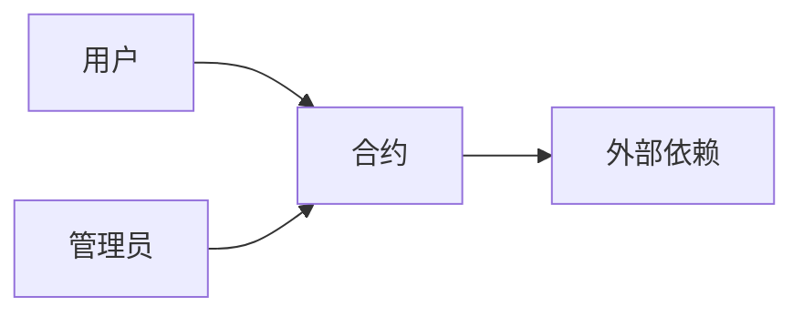
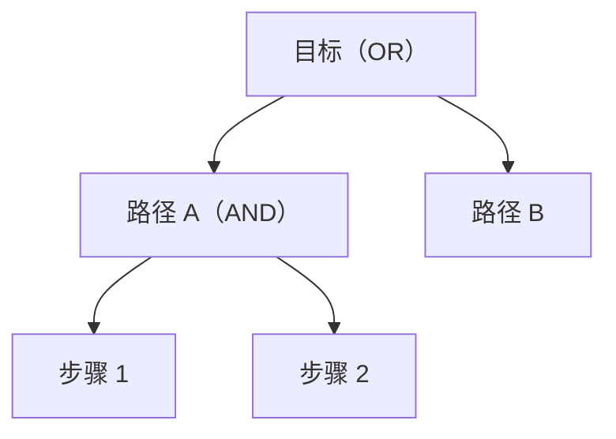
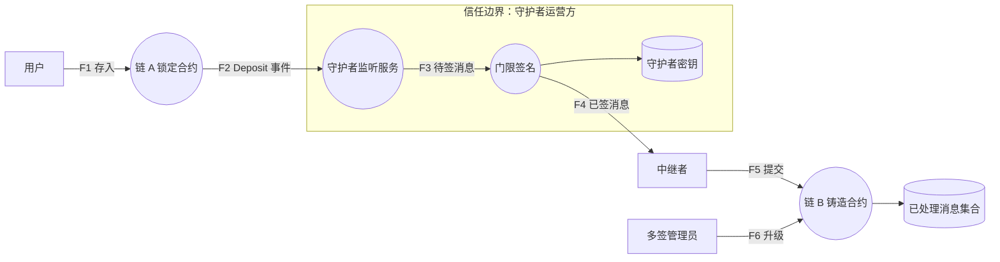

# T02 威胁建模模板

> 用途：评估第 3 阶段使用。用一页纸回答“谁会攻击什么、怎么攻击、我们怎么防”。
> 配套：[A01 评估方法论](../assessment/A01-methodology.md)

## 1. 系统概览

- 一句话描述：
- 数据/资金流图（可粘贴 mermaid）：

## 2. 资产

| 资产 | 位置 | 价值估计 |
|---|---|---|
| 用户资金 | | |
| 协议金库 | | |
| 治理权 / 升级权 | | |
| 签名密钥 | | |

## 3. 角色与信任

| 角色 | 能做什么 | 信任假设 | 若作恶 / 被攻破 |
|---|---|---|---|
| 普通用户 | | 不可信 | |
| 管理员 | | | |
| 预言机 | | | |
| 外部协议 | | | |

## 4. 攻击者画像

- [ ] 外部攻击者（有闪电贷）
- [ ] 恶意用户 / 竞争对手
- [ ] 被攻破的管理员或签名人
- [ ] 恶意或失效的依赖
- [ ] 国家级长期渗透

## 5. 威胁清单（STRIDE 风格，可按需扩展）

| # | 威胁 | 入口 | 影响 | 现有缓解 | 剩余风险 | 对应章节 |
|---|---|---|---|---|---|---|
| 1 | | | | | | |

### 5.1 STRIDE-per-element 工作表

方法见 [A01 附录](../assessment/A01-methodology.md#附录区块链系统威胁建模框架)。外部实体检查 S、R；处理过程检查全部六类；数据存储和数据流检查 T、I、D。

| 元素 | 类型 | 穿过信任边界 | S | T | R | I | D | E | 结论与编号 |
|---|---|---|---|---|---|---|---|---|---|
| | | | | | | | | | |

### 5.2 攻击树（最高价值资产）

- 最低成本路径：
- 修复后的下一条路径：

### 5.3 框架与测试对照

| 威胁编号 | ATT&CK 战术 / AADAPT 条目（写明版本） | 检测手段 | 测试用例（A11） |
|---|---|---|---|
| | | | |

> DREAD 分数只用于讨论。定级使用 [A02](../assessment/A02-risk-rating-reporting.md)。

## 6. 需要重点验证的不变量

1.
2.

## 7. 评审结论

- 最高风险的三个威胁：
- 评估计划调整：

---

## 附录：已填写示例（MiniBridge，本手册虚构系统）

> 所有名称和数值都是示例。

### 示例 1：系统概览

- 一句话描述：用户在链 A 锁定 USDC，5 个守护者中的 3 个签名后，链 B 铸造等量的 mUSDC。

**读图要点：** F2、F4、F5、F6 穿过信任边界。F4 可由任何中继者提交，所以中继者不可信。

### 示例 2：资产

| 资产 | 位置 | 价值估计 |
|---|---|---|
| 用户资金 | 链 A 锁定合约 | 2,000 万美元（示例） |
| 协议金库 | 链 B 手续费地址 | 5 万美元（示例） |
| 治理权 / 升级权 | 4/7 多签 + 48 小时时间锁 | 等同全部锁定资金 |
| 签名密钥 | 5 个守护者的 HSM | 3 把即等同全部锁定资金 |

### 示例 3：角色与信任

| 角色 | 能做什么 | 信任假设 | 若作恶 / 被攻破 |
|---|---|---|---|
| 普通用户 | 存入、提取 | 不可信 | 只能操作自己的资金 |
| 管理员 | 升级、暂停 | 4/7 不合谋 | 时间锁期间用户可退出 |
| 守护者 | 签署消息 | 少于 3 家被攻破 | 3 家被攻破时，可伪造铸造 |
| 中继者 | 提交消息 | 不可信 | 只能延迟，不能伪造 |

### 示例 4：攻击者画像

- [x] 外部攻击者（有闪电贷）
- [x] 恶意用户 / 竞争对手
- [x] 被攻破的管理员或签名人
- [x] 恶意或失效的依赖
- [x] 国家级长期渗透

### 示例 5：威胁清单

| # | 威胁 | 入口 | 影响 | 现有缓解 | 剩余风险 | 对应章节 |
|---|---|---|---|---|---|---|
| 1 | S：伪造 Deposit 事件 | F2 | 无抵押铸造 | 校验事件来源地址和最终性 | 低 | [12](../chapters/12-cross-chain-bridges.md) |
| 2 | T：重放已签消息 | F5 | 重复铸造 | 已处理消息集合 | 低 | [09](../chapters/09-mev-signatures.md) |
| 3 | T：跨链重用签名 | F4 | 在错误的链铸造 | 域分隔符包含链 ID 和合约地址 | 低 | [09](../chapters/09-mev-signatures.md) |
| 4 | I：3 把守护者密钥泄露 | K | 可能损失全部资金 | HSM、独立运营方、每小时铸造上限 | **高** | [18](../chapters/18-wallet-key-management.md) |
| 5 | E：恶意升级铸造合约 | F6 | 全部资金 | 多签、时间锁、公开告警 | 中 | [10](../chapters/10-upgradeable-proxy.md) |
| 6 | D：链 A 重组 | F2 | 重组后已铸造资产失去抵押 | 只处理已最终确定的区块 | 低 | [16](../chapters/16-consensus-chain-security.md) |

### 示例 5.1：工作表片段

| 元素 | 类型 | 穿过信任边界 | S | T | R | I | D | E | 结论与编号 |
|---|---|---|---|---|---|---|---|---|---|
| 中继者 | 外部实体 | 是 | 接受：不信任身份 | — | 不适用 | — | — | — | 只验证签名 |
| F4 已签消息 | 数据流 | 是 | — | #3 | — | 公开 | 中继延迟 | — | 高优先 |
| 铸造合约 | 处理过程 | 是 | #1 | #2 | 事件日志 | 公开 | 上限触发 | #5 | 高优先 |
| 守护者密钥 | 数据存储 | 否 | — | HSM | — | #4 | 3/5 容错 | — | **最高优先** |

### 示例 5.2：攻击树结论

- 最低成本路径：攻破 3 家守护者运营方（AND），路径的主要成本来自 3 次独立入侵。
- 修复后的下一条路径：恶意升级铸造合约，需要 4/7 多签同时被攻破。

### 示例 5.3：框架与测试对照

| 威胁编号 | ATT&CK 战术 / AADAPT 条目（写明版本） | 检测手段 | 测试用例（A11） |
|---|---|---|---|
| 4 | ATT&CK v20：Credential Access；AADAPT 条目待核对 | HSM 调用量告警 | TST-41、TST-43 |
| 2 | 业务逻辑，矩阵未覆盖 | 重复消息告警 | TST-40 |
| 5 | AADAPT 条目待核对 | 升级事件告警 | TST-23、TST-44 |

### 示例 6：需要重点验证的不变量

1. 链 B 的 mUSDC 总供应量 ≤ 链 A 锁定的 USDC 数量。
2. 每个消息 ID 最多被处理一次。

### 示例 7：评审结论

- 最高风险的三个威胁：#4 守护者密钥、#5 恶意升级、#1 伪造事件。
- 评估计划调整：增加 2 人日，用于守护者运营独立性审查，并增加铸造上限测试。
